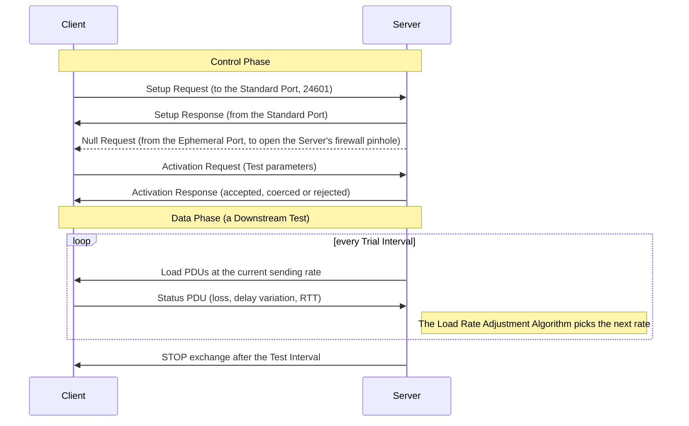

<picture><source media="(prefers-color-scheme: dark)" srcset="docs/assets/logo/udpstp-mark-dark.svg"></picture>

# udpstp

**Measure the capacity your network really delivers.**

udpstp measures how much traffic a network path can carry, along with its loss, delay variation and round-trip time. It is for people who check access lines and circuits, compare network paths, or collect measurements for their own tools.

```console
$ udpstp client --key-file keys.toml --max-hops 12 127.0.0.1
Sending the Setup Request to 127.0.0.1:24601
Setup accepted (Ephemeral Port 57607)
Test activated (Downstream)
The Server ended the Test
...
  Sub-Interval results
  SI  C (Mbps)  Loss Ratio   Lost  Reordered  Duplicates
   1    104.43    0.000000      0          0           0
   2    304.94    0.000000      0          0           0
   3    504.75    0.000000      0          0           0
   4    705.01    0.000000      0          0           0
   5    905.04    0.000000      0          0           0
   6   2049.63    0.000000      0          0           0
   7   4049.68    0.000000      0          0           0
   8   6049.77    0.000000      0          0           0
   9   9256.27    0.013230  10348          0           0
  10   9713.89    0.008982   7337          0           0
...
Final metrics
  Maximum IP-Layer Capacity: 9713.89 Mbps (Sub-Interval 10)
```

This Test ran against a Server on the same machine, so the host set the rate. Between two hosts, the result is the capacity of the path between them.

udpstp is a Rust implementation of the UDP Speed Test Protocol in [RFC 9946](https://www.rfc-editor.org/rfc/rfc9946). A Client and a Server at the two ends of a network path measure its Maximum IP-Layer Capacity with the method in [RFC 9097](https://www.rfc-editor.org/rfc/rfc9097).

## Highlights

- Measures both directions with authenticated Upstream and Downstream Tests
- Reports capacity, loss, delay variation and RTT in your terminal, or as JSON for your own tools
- Combines Test Connections to fill a fast path, and holds a fixed rate with an Operator Key
- Reads OB-UDPST key files and exports compatible JSON

udpstp measures between two hosts that share a key, so you need a Server at the far end of the path. It is not a one-click test against public servers.

## Installation

**Linux**

```sh
curl -fsSL https://udpstp.com/install.sh | sh
```

**macOS**

```sh
brew install pederbe/tap/udpstp
```

**Windows**, in PowerShell

```powershell
irm https://udpstp.com/install.ps1 | iex
```

The [installation guide](https://udpstp.com/docs/guides/installing-udpstp.html) covers signed apt and dnf packages, Arch Linux and OpenWrt packages, portable downloads, Cargo and updates.

## Everyday use

Install udpstp on both hosts. Tests are authenticated by default, so generate a Shared Key.

```sh
openssl rand -hex 32
```

Save the following as `keys.toml` on both hosts, replacing the placeholder with that key, and keep the file private with `chmod 600 keys.toml`.

```toml
[[key]]
admin_key_name = "first-test"
key_id = 1
key_hex = "replace-with-64-hexadecimal-digits"
```

Allow inbound UDP ports 24601 and 49152 to 65535 at the Server. The [quickstart](https://udpstp.com/docs/getting-started.html) covers Windows and other firewall setups.

Start a Server at the far end of the path.

```sh
udpstp server --key-file keys.toml --max-hops 12
```

Run a 10-second Downstream Test, in which the Server sends the load.

```sh
udpstp client --key-file keys.toml --max-hops 12 server.example.net
```

Measure the other direction.

```sh
udpstp client --key-file keys.toml --max-hops 12 --direction upstream server.example.net
```

Use several Test Connections when one does not fill a fast path.

```sh
udpstp client --key-file keys.toml --max-hops 12 --test-connections 4 server.example.net
```

Collect JSON for a script. The second command runs only when the Test completed, and fails when the Test found no Maximum IP-Layer Capacity.

```sh
udpstp client --key-file keys.toml --max-hops 12 --format json server.example.net > result.json &&
  jq -e '.Output.AtMax.MaxIPLayerCapacity' result.json
```

| Option | What it does |
| --- | --- |
| `--key-file FILE` | Authenticate with the Shared Key in this private key file |
| `--max-hops HOPS` | Set MaxHops, the TTL or hop limit of Test traffic. Choose it for your path |
| `--direction upstream` | Run an Upstream Test, in which the Client sends the load |
| `--test-interval SECONDS` | Run the Test for 5 to 60 seconds instead of 10 |
| `--test-connections N` | Run a Multi-Connection Test with N Test Connections |
| `--max-bandwidth MBPS` | State the most the Test is expected to carry, so the Server searches no higher |
| `--format json` | Print JSON results instead of text |

Run `udpstp client --help` and `udpstp server --help` for every option.

## How a Test works



In an Upstream Test, the Client sends the Load PDUs and the Server still decides the rate from what it receives.

## Status

udpstp runs complete Tests and reports their results.

| Area | State |
| --- | --- |
| Authenticated Upstream and Downstream Tests, with text and JSON results | Done |
| Multi-Connection Tests and Operator-only Fixed-Rate Tests | Done |
| Authentication Modes 1 and 2, with Mode 2 the default | Done |
| Adaptive terminal layout, colors and compact results | Done |
| Linux batched I/O and available kernel UDP fast paths | Done |
| Linux systemd unit and Windows service | Done |
| Conformance Records and interoperability tests with OB-UDPST | Done |
| Hosted documentation | Done |
| Release binaries, signed Linux packages and installers | Done |
| OpenWrt packages for x86_64, with an optional procd Server service | Done |

[Platform differences](docs/platforms.md) describes options that depend on the operating system. JSON results, exit statuses, key files and address pseudonyms are stable. The command line, configuration and Server JSON logs can change in minor 0.x releases, with changes listed in the [changelog](CHANGELOG.md).

## Learn more

- [Quickstart](https://udpstp.com/docs/getting-started.html) for your first Test between two hosts
- [Installation](https://udpstp.com/docs/guides/installing-udpstp.html) for packages, portable downloads and Cargo
- [Guides](https://udpstp.com/docs/guides/index.html) for running Tests, [hosting a Server](https://udpstp.com/docs/guides/hosting-a-server.html), Windows and Operator features
- [Understanding the results](https://udpstp.com/docs/understanding-results.html)
- [Command line reference](https://udpstp.com/docs/reference/cli.html)
- [Troubleshooting](https://udpstp.com/docs/troubleshooting.html)
- [Architecture](docs/architecture.md), [contributing](CONTRIBUTING.md) and [security reports](SECURITY.md)

Dual-licensed under [MIT](LICENSE-MIT) or [Apache-2.0](LICENSE-APACHE).
