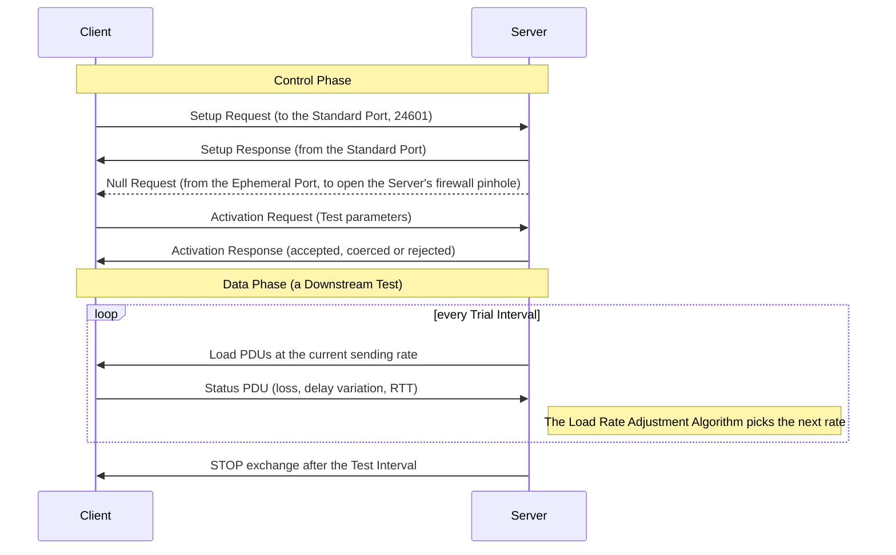

<picture><source media="(prefers-color-scheme: dark)" srcset="docs/assets/logo/udpstp-mark-dark.svg"></picture>

# udpstp

**Measure the capacity your network really delivers.**

udpstp is a Rust implementation of the UDP Speed Test Protocol in [RFC 9946](https://www.rfc-editor.org/rfc/rfc9946). Run a Client and a Server at the two ends of a network path to measure Maximum IP-Layer Capacity with the method in [RFC 9097](https://www.rfc-editor.org/rfc/rfc9097).

Use it to check access lines and circuits, compare network paths, or collect measurements for your own tools.

- Authenticated Tests by default, with Upstream and Downstream measurement.
- Multi-Connection Tests and Operator-only Fixed-Rate Tests.
- Capacity, loss, delay variation and RTT in readable text or JSON.
- Requirements traced to tests and [recorded protocol decisions](docs/conformance/README.md).
- Interoperability with OB-UDPST within the [documented test scope](docs/testing.md#ob-udpst-interop-s2c).

## Install

With [Rust installed](https://rustup.rs), build the current source on Linux, macOS or Windows with one command.

```sh
cargo install --locked --git https://github.com/pederbe/udpstp udpstp
```

See the [installation guide](https://udpstp.com/guides/installing-udpstp.html) for portable binaries, installers and current package manager availability.

## Run a Test

Install on both hosts and give them the same private Key Table. [Getting started](https://udpstp.com/getting-started.html) shows how to create one and open the required UDP ports.

On the Server host

```sh
udpstp server --key-file keys.toml --max-hops 12
```

On the Client host

```sh
udpstp client --key-file keys.toml --max-hops 12 server.example.net
```

This runs a 10-second Downstream Test. Add `--direction upstream` for the other direction, or `--format json` to collect structured results. Choose MaxHops for your path.

## How a Test works



In an Upstream Test, the Client sends the Load PDUs and the Server still decides the rate from what it receives.

## Status

udpstp runs complete Tests and reports their results.

| Area | State |
| --- | --- |
| Authenticated Upstream and Downstream Tests, with text and JSON results | Done |
| Multi-Connection Tests and Operator-only Fixed-Rate Tests | Done |
| Authentication Modes 1 and 2, with Mode 2 the default | Done |
| Adaptive terminal layout, colors and compact results | Done |
| Linux batched I/O and available kernel UDP fast paths | Done |
| Linux systemd unit and Windows service | Done |
| Conformance Records and interoperability tests with OB-UDPST | Done |
| Hosted documentation | Done |
| Release binaries, packages and installers | [Current availability](https://udpstp.com/guides/installing-udpstp.html) |

[Platform differences](docs/platforms.md) describes options that depend on the operating system. JSON results, exit statuses, key files and address pseudonyms are stable from 0.1.0. The command line, configuration and Server JSON logs can change in minor 0.x releases, with changes listed in the [changelog](CHANGELOG.md).

## Learn more

[Guides](docs/guides/README.md) · [Understanding results](docs/understanding-results.md) · [Hosting a Server](docs/guides/hosting-a-server.md) · [Architecture](docs/architecture.md) · [Contributing](CONTRIBUTING.md) · [Security reports](SECURITY.md)

Dual-licensed under [MIT](LICENSE-MIT) or [Apache-2.0](LICENSE-APACHE).
