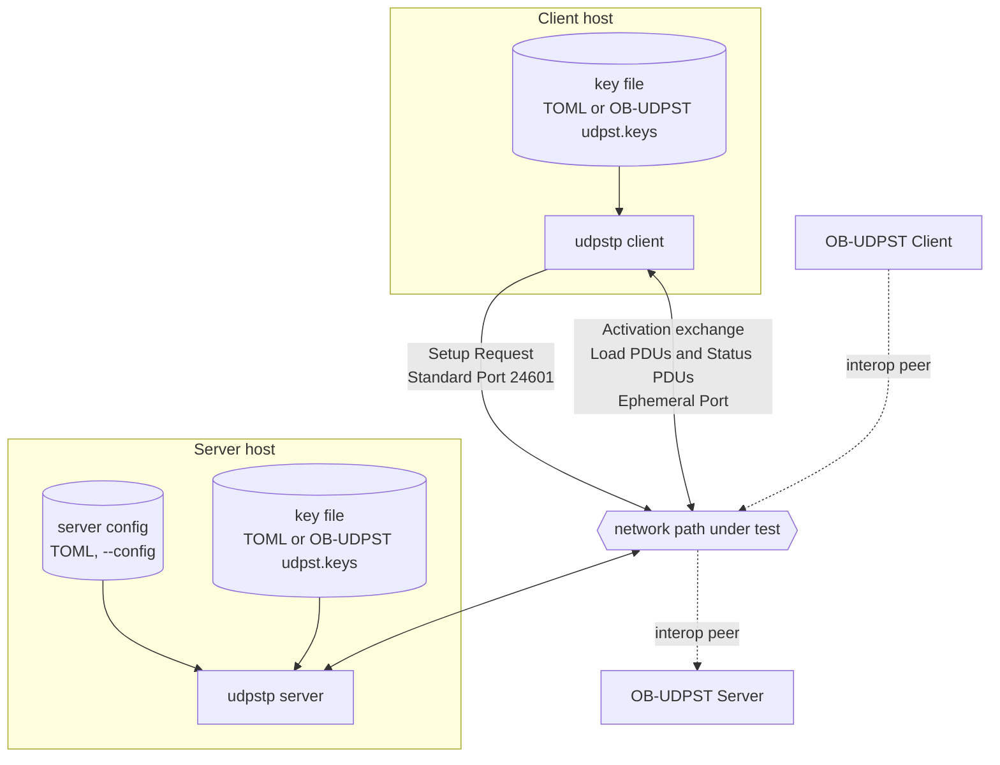
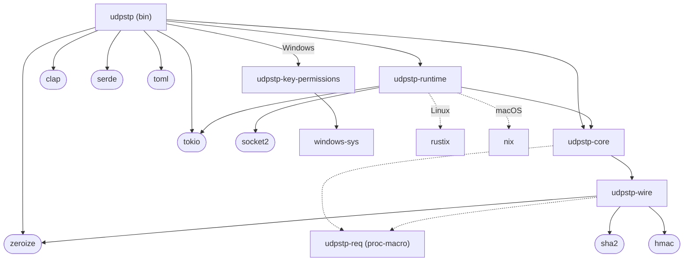
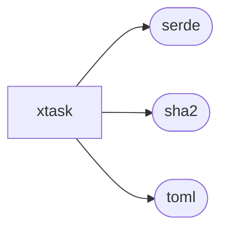
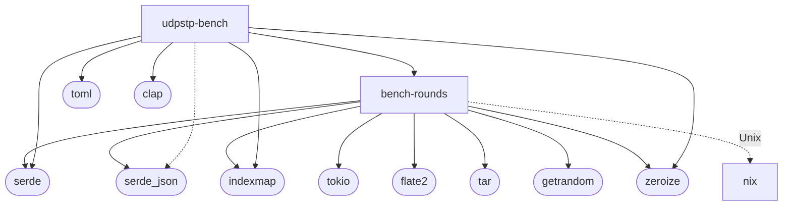
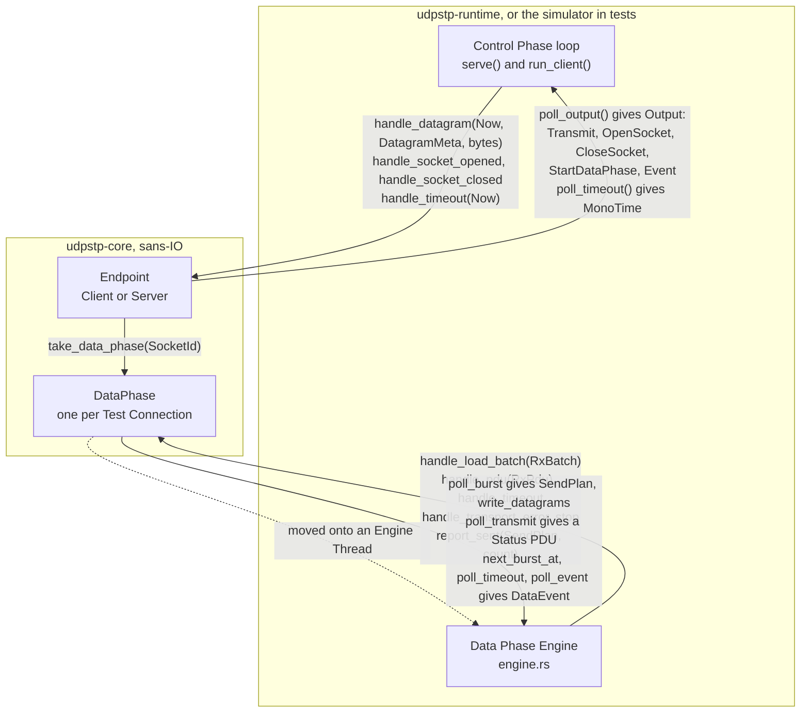
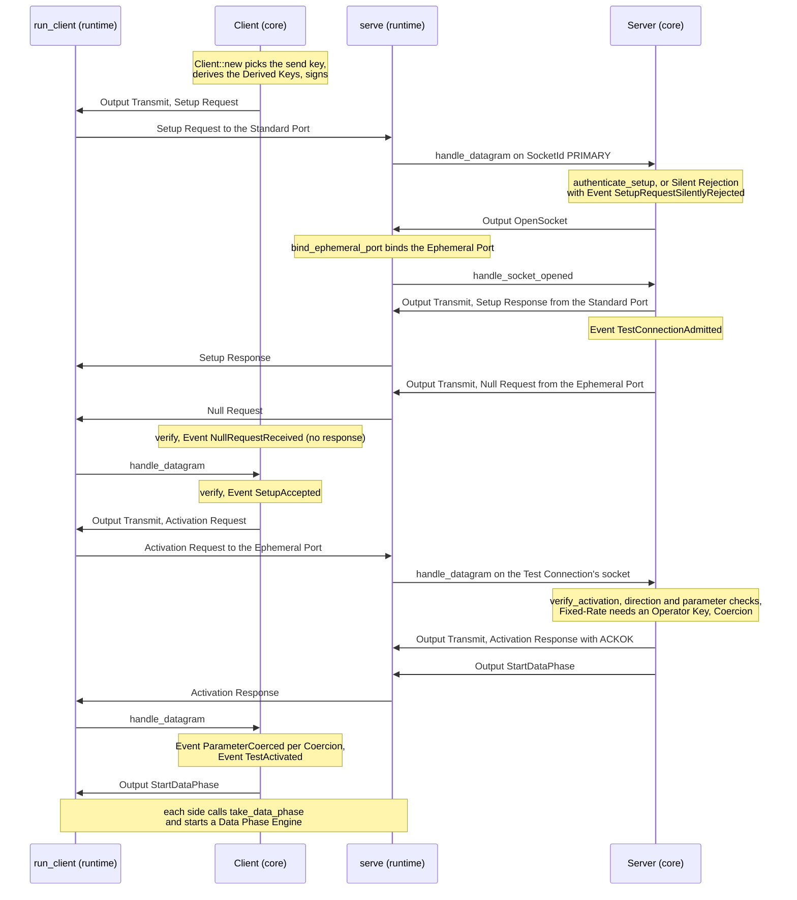
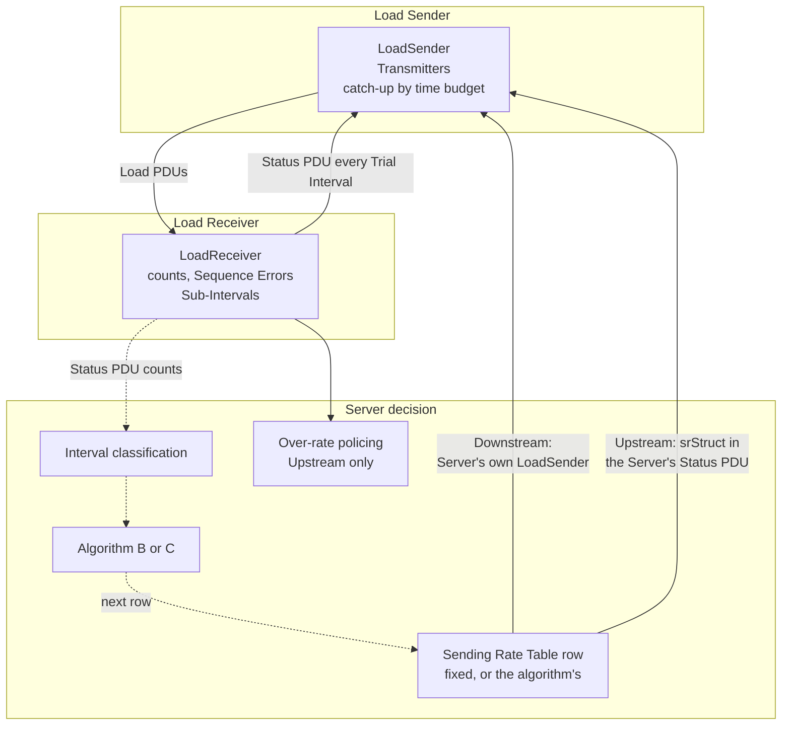
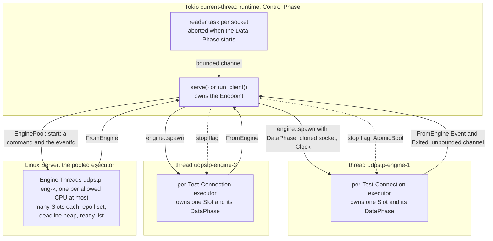
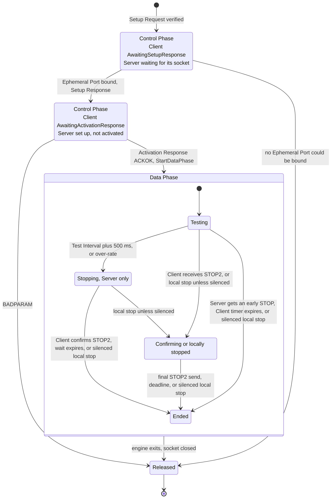

# Architecture

This document describes how udpstp is built: the parts of the system, the crates, the line between protocol logic and I/O, and how a Test Connection moves through its Control Phase and Data Phase. It describes the code on `main`. Anything not built yet is marked **planned**, with its issue number.

Terms are used as [GLOSSARY.md](../GLOSSARY.md) defines them. Decisions are recorded in [docs/adr/](adr/).

## 1. System context

A Client and a Server run the same `udpstp` binary (`udpstp client`, `udpstp server`). The Client sends a Setup Request to the Server's Standard Port (24601). The Server answers from the Standard Port, and every later PDU of the Test Connection uses the Ephemeral Port it allocates, by default from 49152-65535.

<!-- description: The system. A udpstp Client and a udpstp Server each read a key file, a TOML Key Table or an OB-UDPST udpst.keys file, and the Server also reads its TOML configuration. The Client sends a Setup Request to the Standard Port, 24601, and then exchanges the Activation exchange, Load PDUs and Status PDUs with the Server over the Ephemeral Port, across the network path under test. OB-UDPST's Client and Server are shown as interop peers. -->

- **Key files.** Both ends need the same Shared Key. A file whose name ends in `.toml` is read as udpstp's Key Table; any other file is read as an OB-UDPST `udpst.keys` file (`crates/udpstp/src/keyfile.rs`). Keys are never given on the command line. Unix refuses unsafe ownership and group/other content access. Windows inspects and reads the same handle with read-only sharing; supported-policy mismatches and unverified permissions are refused before reading keys, with distinct key file errors (ADR 0015).
- **Server configuration.** Built-in defaults, then the TOML file (`--config`), then command-line options, each overriding the one before. `--print-config` prints the result (`crates/udpstp/src/config.rs`). [Hosting a Server](guides/hosting-a-server.md#write-a-configuration-file) lists every setting and its default.
- **Client options.** `--direction`, `--test-interval`, `--algorithm`, `--fixed-rate` or `--start-row`, `--max-bandwidth`, `--delay-var`, `--random-payload`, `--refuse-coercion` (RFC 9946 parameter names), `--checksum`, `--key-file`, `--key-id`, `--unauthenticated`, `--time-limit`, `--test-connections`, `--min-test-connections`, `--auth-mode` (2 by default), `--mode-1-server`, `--dscp`, `--jumbo`, `--traditional-mtu`, `--max-hops`, `--dont-fragment`, `--socket-buffer-size`, the results' `--format`, `--json-extension`, `--max-loss-ratio` and `--first-mode-sub-intervals` (`crates/udpstp/src/main.rs`). Rows are 0 to 1152. The Trial Interval, Sub-Interval, thresholds and other Activation parameters take the parameter table's defaults (`crates/udpstp-core/src/parameters.rs`).
- **Starting.** `crates/udpstp/src/start/` turns the options into what the runtime runs, one module per role: the Client's Test (its `TestPlan` and the Client's settings for it, `ClientConfig`, which the Multi-Connection Coordinator completes for each Test Connection; DF and MaxHops; socket buffers) and the Server's `ServerOptions`, with the warnings to show first and the configuration errors that stop it, each with its exit status, as data; `main.rs` prints them and runs. The Client reads its key file and pseudonym key file there, once, and the Server its pseudonym key file. What the host allows (a DSCP, DF, the socket buffers it grants) and the Client's name resolution come in from outside, so the rules don't depend on the OS they are tested on.
- **OB-UDPST.** udpstp reads OB-UDPST key files, and runs Tests with OB-UDPST's Client and Server in both directions.

ADRs: [0004](adr/0004-ipv4-based-sizes-in-sending-rate-structure.md) (IPv4-based sizes on either IP version), [0007](adr/0007-arrival-address-via-nix-and-quinn-udp-on-windows-listener.md) (replying from the arrival address), [0009](adr/0009-authunixtime-window-and-setup-signing-interpretations.md), [0010](adr/0010-key-table-rows-lifetimes-and-extensions.md) (Key Table and Operator Keys).

## 2. Crates

| Crate | Role |
|---|---|
| `udpstp-wire` | PDU layouts and codecs, checksum, HMAC-SHA-256 and the KDF. No protocol decisions: decoding checks only size and pduId. |
| `udpstp-core` | The sans-IO protocol core: Client and Server roles, the Client's Multi-Connection Coordinator, the Server's Admission, Key Table, Sending Rate Table, Coercion, and the Data Phase of one Test Connection. |
| `udpstp-runtime` | Sockets, clocks, the Tokio Control Phase loops and the Data Phase Engine. Makes no protocol decisions. |
| `udpstp` | The binary: CLI, Server configuration, key files, exit codes, output. |
| `udpstp-key-permissions` | Windows application support: borrowed-file native inspection, owned descriptor decoding and the supported private-file policy (ADR 0015). No protocol decisions. |
| `udpstp-req` | The `#[req("ID")]` proc-macro attribute that ties tests to Requirements. |
| `xtask` | `cargo xtask req` (Requirement traceability) and known-answer test tooling. |
| `bench-rounds` | The benchmark tooling's general machinery, which knows nothing of udpstp: compatibility helpers for the independent reference fixtures (JSON read and written as Python does, Python's numbers, shell quoting, redaction, the rules' statistics and times); the modules that decide: AWS's calls, a model of EC2 with the `fake-aws` binary tests run, the private records of real calls and their replay against the model, the dead-man switch, cost and the ledger, a host's counters, with the counter script, and sample readers, and the order of Round Runs; the Round bracket, which runs a Round's body between its ledger entry and its Round Teardown, whatever happens; and the adapters that do a Round's I/O and decide nothing: signals that only raise a flag, programs run in process groups of their own, hosts over ssh or this machine, fetched archives unpacked, the keys' private directory, the static provider, the `aws` CLI run for the AWS provider, whose rented hosts it reaches over ssh, and the Round Teardown's destroying of what a provider made. The Linux sampler produces CPU, thread and UDP records. Never published. |
| `udpstp-bench` | udpstp's benchmark Rounds on `bench-rounds`. The first Round's modules that decide: its matrix, read as the Python reads it, with its Round Runs in order and the checks and figures of a Round's plan; udpstp's and OB-UDPST's Client and Server command lines; each Round Run's Maximum and Highest IP-Layer Capacity and the criterion; and the Round's report, byte for byte the Python's or none, read from its `--out` through a seam. The first Round's body, which `bench-rounds`' Round bracket runs: its keys, hosts, path check, matrix and Servers, making the Python's calls on each host. And for either Round, the pinned OB-UDPST built on a host through `bench-rounds`' `Shell`; and the `udpstp-bench` binary, whose `round` runs either Round type and whose `report`, `scale-report` and `proxy-report` write their reports. Server-scale modules own planning, judging, scheduling, host preparation and collection. Separate modules own the earlier campaign report, loopback precision suite and first-Round capture lifecycle. It reads udpstp's JSON results and the Server's JSON log as any consumer does, never through udpstp's crates, so the judging stays independent of the code it judges. Never published. |

The graphs highlight direct dependencies (solid) and development dependencies (dashed), grouped into the protocol, development tooling and benchmark tooling. They show the main relationships rather than every supporting library.

<!-- description: The protocol crates and their dependencies. The udpstp binary depends on udpstp-core, udpstp-runtime, tokio, clap, serde, toml and zeroize, and on udpstp-key-permissions with windows-sys on Windows. udpstp-runtime depends on udpstp-core, tokio and socket2, with rustix on Linux and nix on macOS; udpstp-core on udpstp-wire; udpstp-wire on hmac, sha2 and zeroize. udpstp-core and udpstp-wire use udpstp-req in their tests. -->

<!-- description: The development tooling. xtask depends on serde, sha2 and toml. -->

<!-- description: The benchmark tooling's crates. They depend on none of udpstp's protocol crates: bench-rounds depends on serde, serde_json, indexmap, tokio (for its signals), flate2, tar, getrandom and zeroize, with nix on Unix; udpstp-bench depends on bench-rounds, clap, serde, toml, indexmap and zeroize, with serde_json in its tests. -->

Of udpstp's own crates, only `udpstp-runtime` and the binary depend on Tokio; `bench-rounds` uses it only to take signals. The core depends on nothing but `udpstp-wire`, so it builds and tests without an async runtime or a network. The workspace forbids own `unsafe` except for the isolated permission helper below.

**Windows permission boundary:** [ADR 0015](adr/0015-windows-shared-key-private-file-policy.md) isolates the native adapter in `udpstp-key-permissions/src/native.rs`, the sole module allowed to override its crate root's denial of `unsafe`. Its safe interface borrows the file being read and returns owned data. Safe descriptor decoding and the policy live beside it and explicitly forbid `unsafe`, as do the protocol core, wire code, application and network runtime. The loader refuses mismatches and unverified permissions before reading content. Client errors go to stderr; Server errors also reach the configured startup log. Policy matches are quiet. The settings-only preview bypasses key loading, logs and listeners; ordinary `--print-config` validates keys.

ADRs: [0003](adr/0003-tokio-control-plane-precise-data-phase-engine.md) (why Tokio stays out of the core and out of the Data Phase).

## 3. The sans-IO core and the runtime

The core never performs I/O and never reads a clock (`crates/udpstp-core/src/lib.rs`). The runtime, or the test simulator, feeds it received datagrams and the time, and acts on what it returns. The boundary has two interfaces: `Endpoint` for the Control Phase of a whole Client or Server, and `DataPhase` for one Test Connection's Data Phase.

<!-- description: The line between the runtime and the sans-IO core. The runtime's Control Phase loop gives the core's Endpoint each datagram, socket event and timeout with the time, and polls it for outputs: datagrams to send, sockets to open or close, a Data Phase to start, and events. For each Test Connection it takes a DataPhase from the Endpoint and moves it onto an Engine Thread, where the Data Phase Engine gives it received Load PDUs, Status PDUs, timeouts and transport errors, and asks it for Send Plans, Status PDUs and events. -->

**Time.** Every input carries a `Now`: a `MonoTime` (monotonic, any origin) and a `WallTime` taken together (`crates/udpstp-core/src/time.rs`). Timers and intervals use `MonoTime`. Wall-clock time is used only where the protocol carries it (authUnixTime, lpduTime, spduTime). The Data Phase builds lpduTime and spduTime from the monotonic reading plus a wall-clock offset fixed at activation, so a wall-clock step does not move them. The runtime's `Clock` (`crates/udpstp-runtime/src/clock.rs`) is the Test Time Base: CLOCK_MONOTONIC_RAW on Linux, paired with the wall clock read between two RAW readings, and `std::time::Instant` elsewhere. Linux can't sleep on RAW, so waits are durations on CLOCK_MONOTONIC (sleeps, ppoll timeouts, Tokio instants mapped from a fresh reading), and the waiter checks the time again on RAW when it wakes.

**Control Phase interface** (`crates/udpstp-core/src/lib.rs`, `io.rs`, `event.rs`):

| Direction | Type | Meaning |
|---|---|---|
| in | `handle_datagram(Now, DatagramMeta, &[u8])` | A datagram with its socket, source, local address, `IpVersion`, received TOS where the runtime read it (`None` on Control Phase sockets, which the runtimes don't ask the OS for: Control PDUs carry no DSCP) and actual length. |
| in | `handle_socket_opened` / `handle_socket_closed` | A socket the core asked for is bound, or a socket is gone. Closing releases the Test Connection's Admission. A Data Phase's socket goes when its Data Phase Engine exits, on every exit, and the runtime reports it after passing on the engine's last `DataEvent`; the core never asks to close it. |
| in | `handle_timeout(Now)` | The deadline from `poll_timeout` has passed. |
| in | `handle_interrupt(Now)` | The Client user interrupted the Test (Ctrl-C, a signal to stop, or a closed standard output): the Multi-Connection Coordinator stops it as `TestAbort::Interrupted`, each Test Connection in its Data Phase sending its STOP2. |
| out | `Output::Transmit(Transmit)` | Send a payload from a `SocketId` to an address. |
| out | `Output::OpenSocket` / `Output::CloseSocket` | Bind a Test Connection's socket (the Ephemeral Port), or close one. |
| out | `Output::ConnectSocket` | Connect a Server's Test Connection socket to `peer`, the source of its first Activation Request that passed verification, before the Activation Response is sent: the OS then delivers only the Client's datagrams and reports ICMP errors about it. A connected socket sends without an address. |
| out | `Output::StartDataPhase` | Hand the Test Connection to a Data Phase Engine and accept datagrams only from `peer`. |
| out | `Output::Event(Event)` | A typed event to log or show: admission, Silent Rejections with a `SilentRejectionReason`, ignored Setup Requests, Coercions, rejections, activation. |

`SocketId::PRIMARY` is the Server's Standard Port listeners: the IPv4 and IPv6 wildcards, or the addresses `listen` gives, each reply leaving from the listener its request arrived on. A listener on a specific address never sees multicast or broadcast Setup Requests. Every other `SocketId` is a Test Connection's socket; the Client's are all opened on request, `SocketId(mcIndex + 1)`. The Client's Multi-Connection Coordinator (`crates/udpstp-core/src/coordinator.rs`) also emits `Output::TestConnectionEvent`, a Test Connection's event with its socket, and `Output::StopDataPhase` for a Data Phase it stops when it aborts a Test. Their only deadlines are the Control Phase timers (RFC 9946 §6.1, §6.2.2): the Client's Test initiation timer ends a Control Phase that hasn't reached the Data Phase 3 s after the Setup Request, or sooner with `--time-limit` (`ControlPhaseFailure::TestInitiationTimedOut`, which names the exchange it expired in and why the last response ignored there was, the cause the Client's exit status and what it says follow ), and the Server closes a Test Connection with no valid Activation Request 3 s after its Setup Response (`Event::ActivationWatchdogExpired`), which releases it.

**Data Phase interface** (`crates/udpstp-core/src/data_phase.rs`), the one ADR 0008 froze:

- `poll_burst(Now, horizon)` returns the next due `SendPlan`: a heap-free, `Copy` Send Plan of at most `MAX_RUNS` runs of equal-sized datagrams with contiguous sequence numbers. `horizon` must be zero while kernel pacing is off.
- `write_datagrams(&SendPlan, Now, buf)` writes the Load PDU headers into a runtime-owned buffer just before the send, with one lpduTime for the whole Burst.
- `report_sent(&SendPlan, sent)` is the only backpressure channel. The unsent datagrams become Deferred Datagrams: they lead the next Send Plan with their sequence numbers and a fresh lpduTime. When at least a Burst's worth is still deferred, the next new Burst is a Withheld Burst (`DataEvent::BurstsWithheld`). Each Send Plan is reported before the next is polled.
- `handle_load_batch(RxBatch)` takes header-only reads (`RxDatagram`: the first 32 bytes, actual length, optional kernel timestamp and TOS) with a clock pair around the read. The core converts a kernel timestamp to Test Time Base with that pair, and drops the read's delay samples if the pair disagrees. On Linux the engine reads them in batches with each datagram's kernel timestamp and TOS; where a platform gives no timestamp the core uses the read time.
- `handle_pdu(RxPdu)` takes a Status PDU, with its kernel receive timestamp where there is one: rttRespDelay counts from it. `poll_transmit(Now, buf)` writes the next Status PDU when one is due.
- `handle_transport_error(TransportError)` takes `Icmp`, `MsgSize` or `TimeExceeded` and counts them as `DataEvent::IcmpErrors`, `PathMtuExceeded` and `HopLimitExceeded` (ADR 0006). On Linux the engine classifies each ICMP error from the socket's error queue; the Client's Control Phase reads it too, and the Coordinator reports a path error there as `Event::PathError`.
- `stop(Now)` ends the Data Phase. `poll_event()` returns coalesced `DataEvent`s, ending with `DataEvent::Ended(EndReason)`, which a Client's `DataEvent::TrialIntervalsCounted` comes just before.

The simulator in `crates/udpstp-core/tests/harness/sim.rs` implements the runtime's side of both interfaces deterministically from a seed, so protocol tests run without sockets. It drives the cores production does, and only those: a `Server`, and for each Client a `Coordinator`, the Client role's one endpoint; its per-Test-Connection `Client` is private to it. A Test a scenario spreads over several Clients, or one the Coordinator would never make (an mcIndex used twice, two directions), is played by scripted Clients sending requests built from the RFC, since a Coordinator runs a whole Test from one host. The plan-executor contract runs the same checks against the simulator's executor and the real Data Phase Engine on loopback: Burst spacing, ordering, partial-send reporting and the timestamp domain ([testing.md](testing.md#cli-and-loopback-integration-tests-s2a-s2b)).

ADRs: [0003](adr/0003-tokio-control-plane-precise-data-phase-engine.md), [0006](adr/0006-classify-transport-errors-on-receive-and-send.md) (transport errors as a core input), [0007](adr/0007-arrival-address-via-nix-and-quinn-udp-on-windows-listener.md) (a source address on outgoing datagrams: `Transmit::source`), [0008](adr/0008-data-phase-engine-per-core-epoll-with-bounded-catch-up.md) (the frozen Data Phase interface).

## 4. Control Phase

The Control Phase runs on one current-thread Tokio runtime (`tokio_runtime()` in `crates/udpstp/src/main.rs`). On each side, one loop owns the core: `serve()` in `crates/udpstp-runtime/src/server.rs` and `run_client()` in `crates/udpstp-runtime/src/client.rs`. On the Server, a reader task per socket (`spawn_reader` in `transport.rs`) passes datagrams to that loop through a bounded channel. Datagrams beyond the channel's capacity are dropped and counted.

<!-- description: The Control Phase through each end's runtime and core. The Client core signs a Setup Request, which the Client runtime sends to the Server's Standard Port. The Server core authenticates it or drops it silently, has the runtime bind an Ephemeral Port, and sends the Setup Response from the Standard Port and a Null Request from the Ephemeral Port. The Client verifies both and sends an Activation Request to the Ephemeral Port. The Server verifies it, checks its direction and parameters, requires an Operator Key for a Fixed-Rate Test, applies any Coercion and answers with an Activation Response. Both ends then start their Data Phase. -->

Step by step, with the code that handles it:

1. **Setup Request.** `Client::start` (`crates/udpstp-core/src/client.rs`) picks the Key Table row valid for sending, derives the Derived Keys from the authUnixTime the request carries, and signs the request with the Client Authentication Key. Without a key file or `--unauthenticated` it fails with `ControlPhaseFailure::NoAuthenticationConfigured`.
2. **Verification and Admission.** `Server::handle_setup_request` (`crates/udpstp-core/src/server.rs`) checks a Setup Request in the order the Conformance Record `setup-check-order` records. A request from or to a multicast or broadcast address is dropped silently, and one whose arrival address the runtime couldn't tell is ignored, not refused (`Event::SetupRequestIgnored` with `SetupIgnoreReason::ArrivalAddressUnknown`, ADR 0007), since the reply must leave from it; the Client retries. Then the size, the checksum when checksum use is configured and the field is populated (RFC 9946 §5.6's rule for every PDU, `checksum_use::passes`, with udpstp-wire's `checksum::control_valid` saying whether the field matches; senders fill it last with `checksum::fill_control`), then authMode, the keyId's row and its accept lifetime, then the global budget for unverified Setup Requests (dropped silently beyond it), then the digest (with Derived Keys cached per row and authUnixTime, `crates/udpstp-core/src/budget.rs`), then the ±5 s window. Every failure is a Silent Rejection reported as `Event::SetupRequestSilentlyRejected` with a `SilentRejectionReason`; with `troubleshooting` on, authentication failures are answered too, unsigned (AUTHREQ, AUTHNC, AUTHINV, AUTHFAIL, AUTHTIME). An authentic request then passes the replay cache, which drops a replay silently, and spends its Source's budget (`source_setup_burst`, 48, refilled at `source_setups_per_second`, 5); beyond it, a signed CONNFAIL. Requests in Unauthenticated Mode, which have no HMAC, don't spend it. Then the Key Table row's budget (`key_setup_burst` and `key_setups_per_second`, 1000 each), which Unauthenticated Mode's requests spend as one row; beyond it, silence, so a key holder's flood costs at most that many admissions. Then the options: an authentic request (or one allowed in Unauthenticated Mode) with another protocolVer, or modifierBitmap flags other than CHSR_JUMBO_STATUS alone, gets a coded rejection (BADVER with the expected version, BADJS, BADTMTU), after the replay cache so a replay stays silent. Last comes Admission (`crates/udpstp-core/src/admission.rs`), each of whose refusals is a Setup Response, signed in an authenticated mode:
   - A duplicate of an admitted Setup Request from the same address is ignored, not refused (`SetupIgnoreReason::DuplicateSetupRequest`).
   - The Multi-Connection checks refuse with MCINVPAR an mcIdent of 0, an mcIndex not below mcCount or already in use in the Test, and a Test Connection that disagrees with the Test's others on mcCount, authMode or (when authenticated) keyId; a Test is its Client IP address plus mcIdent, and never has to be complete.
   - A new Test from a Source (an IPv4 address or IPv6 /64) that already runs as many as `tests_per_source` allows (1 by default), then a new Test past its Source's or Key Table row's Quota of Tests or load bytes per Quota Period, when one is set, are refused with CONNFAIL. Only activated Tests count, so a spoofed Setup Request can't hold a Source's place or use its Quota; a Test's first Activation Request checks both again, and refuses with BADPARAM a Test that Tests set up with it pushed past them.
   - A missing maxBandwidth when `require_max_bandwidth` is on (NOMAXBW).
   - The per-Test cap (`test_connections_per_test`, 24, counted over the Test's whole life so one kept alive can't start new measurements under it), then the places reserved by activated Tests against the global cap (`max_test_connections`, 256), both CONNFAIL. When the Test Connections held unactivated fill their separate share (`max_unactivated_test_connections`, half of the global cap but at least the per-Test cap by default; configurable above the global cap), a Setup that would otherwise be let in closes the oldest of the Key Table row holding the most of them, those of Unauthenticated Mode counting as one group, so a flooding key evicts its own (`Event::UnactivatedTestConnectionEvicted`).
   - The Admitted Rate Cap (`admitted_rate_cap`), then one Test's share of it (`max_test_share`), both CAPEXC. maxBandwidth counts per Test Connection with CHSR_USDIR_BIT masked, against each direction's cap separately, but only for activated Tests: a Test reserves its whole rate, in each direction its Test Connections state, when its first Test Connection activates, so a Setup never activated holds none, and of Tests admitted together past the cap the first to activate runs whole while the other is refused whole with BADPARAM. From then on each of its admitted Test Connections holds its rate, one still waiting for its socket included.

   On success it asks for a socket, and `handle_socket_opened` sends the Setup Response with the Ephemeral Port as testPort and starts the Activation Watchdog. A Setup holds its place in the unactivated share (only activated Tests reserve global places and rate) from acceptance, before its socket opens, until `handle_socket_closed`; a socket that can't be opened is refused with CONNFAIL. `Admission` keeps every admitted Test Connection with its Test, its Source and the Quotas, and checks a Test Connection's first valid Activation Request in this order: the direction its maxBandwidth was admitted for, then for its Test's first the Tests per Source, the global Test Connection cap, the Admitted Rate Cap and the Quotas, which it then takes, then the Test's one direction. Its first activation reserves global places for every admitted sibling, including one still awaiting its socket; a Test that no longer fits remains refused with BADPARAM (`ActivationRejection::TestConnections`) until all its Test Connections close, so closing a refused sibling cannot let the rest start. The Server keeps authentication, the budgets, the PDUs, the Activation Watchdog and the events.
3. **Null Request.** Right after the Setup Response, `handle_socket_opened` sends a Null Request (`crates/udpstp-wire/src/null.rs`) from the Ephemeral Port, signed like the Setup Response in mode 1, so the Server's firewall lets the Client in. The Client verifies it if it arrives (`Event::NullRequestReceived`, or `NullRequestIgnored`) and never answers; nothing depends on it. It leaves from the Ephemeral Port, which is bound to the address the Setup Request arrived on.
4. **Activation Request.** The Client authorizes the Setup Response's source against local Server selection before examining its contents: the selected Server endpoint, or in an authenticated mode an explicit per-Server alternate IP address, from the selected Standard Port and IPv6 scope. `Client::handle_setup_response` then verifies the response with the Server Authentication Key and sends the Activation Request to the signed Ephemeral Port at that authorized address. Neither a verified digest nor a Null Request authorizes another IP address. A response that fails verification is ignored (`Event::SetupResponseIgnored`); if it came from the selected Server's address and rejects this Test Connection's request, its code is still reported (`Event::UnverifiedSetupRejection`) as a hint when the Test initiation timer expires. A verified rejection ends the attempt with `ControlPhaseFailure::SetupRejected(SetupRejectionCode)`, and an undefined code with `UnknownSetupResponse`. The runtime sends only destinations selected by the core.
5. **Activation Response.** `Server::handle_activation_request` checks authMode and keyId against the Setup's, then the digest and time. It rejects with CHTA_CRSP_BADPARAM an unknown direction, a second direction within one Test, an algorithm other than B or C, a Fixed-Rate Test without an Operator Key, a second activated Test from the Source, and, when an Admitted Rate Cap is set, a direction other than the one the Setup's maxBandwidth was admitted for, or a Test whose maxBandwidth no longer fits the cap because another Test admitted with it activated first. A rejection closes the Test Connection's socket. On acceptance it picks the Sending Rate Table row, no higher than the row matching the Setup's stated maxBandwidth (a higher requested or Fixed-Rate row is coerced to it), sends the Activation Response, and creates the `DataPhase`.
6. **Coercion.** Both ends compute the differences between request and response with `coercions()` (`crates/udpstp-core/src/coercion.rs`) and emit them as events. A Client configured to refuse a Coercion ends the Test with a STOP2 PDU.

**Multi-Connection Coordinator.** The Client runs every Test through `Coordinator` (`crates/udpstp-core/src/coordinator.rs`), the only Client-side endpoint the core exports: one `Client`, private to it, per Test Connection, spread round-robin across the Servers, each on its own socket. Every Setup Request goes out at once, and each `Client` holds its Activation Request. The Activation Requests go out together when every Setup has ended, or at the Setup deadline (1 s before the time limit, or half of it) once at least the Minimum Test Connections have succeeded; the rest are given up (`Event::TestConnectionAbandoned`). As soon as fewer than the minimum can succeed, the Test aborts (`Event::TestAborted`): before any Activation Request if it happens during the Setups. Each Data Phase starts when its own Activation Response accepts it. Each response's parameters must match the first's except for the Sending Rate Table row (`TestParameters::same_test`), or the Test aborts, and so does a Test Connection that refuses a Coercion. An abort stops the Data Phases that run, and answers an acceptance still on its way with a stop, so a Server stops its load within a round trip; one that arrives after the time limit goes unanswered, and the Server stops for want of Status PDUs. maxBandwidth is split equally, rounded down. The Load Receivers of a Downstream Multi-Connection Test keep their Status PDUs and Sub-Intervals to one grid, from when the Activation Requests went out plus the shortest Setup round trip (`DataPhaseSetup::grid`), so Sub-Intervals of the same number cover the same time and `MeasurementResults::of_test` sums them; one closed late by a stall, or that ran less than half its time, is no measurement. In an Upstream Test each Server keeps its own Sub-Intervals, so the sum by number is approximate, and the results say how far apart they were learned (`MeasurementResults::approximate`). The on-wire subIntSeqNo stays a per-Test-Connection count, so the Server's log numbers Sub-Intervals its own way. Once running, a Test Connection fails when its Data Phase stops hearing its peer (`DataEvent::TrafficStopped`, which carries when the silence began), or ends any way but complete; the runtime and the simulator pass every Data Phase event on with `Endpoint::handle_data_event`. The Test goes on while at least the Minimum Test Connections haven't failed, and otherwise stops the healthy ones; two or more falling silent within three Trial Intervals of each other are a path failure and stop the Test even when enough remain (`TestAbort::TestConnectionsTimedOut`). An abort mid-Test happens only while a healthy Test Connection is left to stop; those that fell silent are left to their Watchdog (ADR 0002).

A replay cache (`crates/udpstp-core/src/replay.rs`), shared by every socket, drops a verified mode 1 Setup or Activation Request seen again while it could still pass the time window (`SilentRejectionReason::Replayed`); Activation Requests are keyed on their sender too, since a Multi-Connection Test's can be identical. Unauthenticated Mode bypasses it. In mode 2 every Status PDU is signed by its sender and verified by the Data Phase that receives it (`StatusAuth` in `crates/udpstp-core/src/data_phase.rs`).

ADRs: [0001](adr/0001-kdf-fixed-input-layout-from-appendix-a.md) (KDF layout), [0009](adr/0009-authunixtime-window-and-setup-signing-interpretations.md) (time window, signing, what the digest covers), [0010](adr/0010-key-table-rows-lifetimes-and-extensions.md) (key selection, Operator Keys), [0007](adr/0007-arrival-address-via-nix-and-quinn-udp-on-windows-listener.md) (the arrival address).

## 5. Data Phase feedback loop

The Load Sender sends Load PDUs in Bursts from up to two Transmitters, as the Sending Rate Structure describes. The Load Receiver counts what arrives, including Sequence Errors, and sends a Status PDU every Trial Interval, starting one Trial Interval after the first Load PDU. The Server decides the rate in both directions.

<!-- description: The Data Phase's feedback loop. The Load Sender's Transmitters send Load PDUs to the Load Receiver, which counts them, finds Sequence Errors, keeps Sub-Interval statistics and sends a Status PDU every Trial Interval. On the Server, interval classification feeds algorithm B or C, which picks the next Sending Rate Table row: the Server's own Load Sender uses it in a Downstream Test, and the Server's Status PDUs carry it to the Client in an Upstream Test. In an Upstream Test the Server also polices the rate it receives. -->

What exists today (`crates/udpstp-core/src/data_phase.rs`):

- **The row.** The Server takes the row from the Activation Request: row 0 for CHTA_SRIDX_DEF, otherwise srIndexConf capped at the row the Client's maxBandwidth allows, and, for a search without an Operator Key, at `max_start_row` (`Server::requested_row`); a search then climbs from there up to the maxBandwidth row. The Sending Rate Table (`sending_rate_table.rs`) has OB-UDPST's 1153 rows for the Server's CHSR_JUMBO_STATUS and CHSR_TRADITIONAL_MTU settings, which a Setup Request must match: row N is N Mbps up to row 1000, 1250-byte packets or 1500 with Traditional MTU; above it OB-UDPST's rates, Jumbo rows fitted to the Server MTU (`server_mtu`, 1500 by default) with more, smaller packets, each row never above its rate. The Server goes no higher than the first row at the table's top rate, so a search can't climb into repeated rows. At high rates the portable engine may fall behind well before the table's top, sending a packet a call and receiving one a call on Windows and macOS; on Linux, which sends and reads in batches, a Load Sender's thread topped out at about 4–5.6 Gbps over loopback in WSL2 (Skipped Bursts and loss report it; linux-batched-sending.md). The Load Rate Adjustment Algorithm moves the row after each Trial Interval, except in a Fixed-Rate Test.
- **Downstream.** The Server is the Load Sender and sends from its row. The Client's Status PDUs carry a zero Sending Rate Structure.
- **Upstream.** The Server is the Load Receiver, and each of its Status PDUs carries its row's Sending Rate Structure. The Client applies it with `LoadSender::set_rate` after sanitising it to OB-UDPST's field limits.
- **Catch-up by time budget.** A missed Burst less than the catch-up budget late (1 ms, 2 ms on Windows, set by the runtime; ADR 0012) is still sent, oldest first, one Send Plan at a time; older ones are Skipped Bursts, reported as `DataEvent::BurstsSkipped`. The most recent missed Burst always goes (ADR 0008, ADR 0012).
- **Over-rate policing.** As the Load Receiver, the Server stops the Test Connection after 3 Trial Intervals in a row above 1.5 times the highest rate it assigned within the last second (`EndReason::OverRate`; ADR 0011).
- **Stale Status PDUs.** A Status PDU whose spduSeqNo isn't greater than the last one processed only counts as heard: it can't change the rate, deliver STOP or be echoed for RTT, and is reported as `DataEvent::StaleStatusPdus`. Load PDUs carry spduSeqErr, the Status PDUs missing before the latest one, as OB-UDPST counts it.
- **IPv6.** A Load Sender on IPv6 takes 20 bytes off every size in the Sending Rate Structure.
- **Delay variation and RTT.** The Load Receiver takes each in-order Load PDU's receive time minus its lpduTime, in ms rounded as OB-UDPST rounds, and reports it less the running minimum (clockDeltaMin). The Load Sender echoes the latest spduTime with rttRespDelay; the Load Receiver turns that into rttMinimum and rttVarSample. Both run on the Test Time Base, so a wall-clock step or slew during a Test changes neither.
- **Interval classification.** The Server classifies each Trial Interval as a Clean, Errored or Hold Interval, from the Status PDU it receives (Downstream) or sends (Upstream), and reports it as `DataEvent::TrialIntervalClassified` (`crates/udpstp-core/src/interval.rs`). DelayVar is the maximum one-way delay variation, the delay range the RFCs judge (the average if the Server's `delay_var_statistic` setting says so, as OB-UDPST does), or the latest RTT sample when useOwDelVar is off. An interval with no delay sample is never clean. The Client classifies them too, the Status PDUs it sends (Downstream) or receives (Upstream), always by the maximum, only to count them (`IntervalCounter`, counters only): as its Data Phase ends, `DataEvent::TrialIntervalsCounted` says how many were Clean, Errored and Hold Intervals, how many of the Hold Intervals had no delay sample, and whether slowAdjThresh Errored Intervals ever came back to back, confirming Congestion. It can't see the Server's Lost Status Backoffs, and an OB-UDPST Server classifies by the average by default, so the two counts can differ.
- **Algorithm B.** Each classified Trial Interval moves the Server's Sending Rate Table row (`crates/udpstp-core/src/algorithm.rs`), and the row it chose rides on the classification event. In Fast Mode a Clean Interval adds highSpeedDelta rows, up to the 1 Gbps row. slowAdjThresh Errored Intervals back to back latch Congestion Confirmed and take 3 × highSpeedDelta rows off once (ADR 0005); every other change is one row. Downstream the Server sends at the new row at once; Upstream the row goes out in the Status PDU that reports the Trial Interval. A Fixed-Rate Test holds its row.
- **Algorithm C.** In Fast Mode it doubles the row on every second Clean Interval (row 0 goes to row 1 first), jumping to the 1 Gbps row when doubling would pass it. Its single steps count toward RetryThresh (5 at first); at it, a Fast-Mode Retry clears Congestion Confirmed, and after a retry from a step up RetryThresh grows by 5. The Client asks for it with `--algorithm c`.
- **Lost Status Backoff.** In a Downstream Search Test, when no valid Status PDU has arrived for upperThresh + (2 + w) × trialInt since the last one (or since activation), the Server backs off as for an Errored Interval, which can confirm Congestion, and w counts up. w starts at the Setup Response's round trip divided by trialInt, rounded up and capped below the 1 s Status PDU timeout, so a long path gets no backoff before its first Status PDU; any valid Status PDU, stale or not, starts it over (RFC 9097 §8.1, ADR 0005 as amended). A backoff is reported as `DataEvent::LostStatusBackoff`. Upstream Tests rely on the 1 s timeout.

The core computes a Test's measurement results from the Data Phase's events (`MeasurementResults` in `crates/udpstp-core/src/results.rs`): one Test Connection's, or a Multi-Connection Test's summed, with each Sub-Interval, the IP-Layer Sender Bit Rate over it, measured by the Load Sender or else estimated by the Load Receiver, and each Capacity Mode's Maximum and Highest IP-Layer Capacity, under the Client user's `Evaluation` (Performance Criterion and Capacity Mode split). When the Client learned each Sub-Interval is a runtime fact, which the binary keeps. It also judges a Search Test's searches (`SearchTest` in `crates/udpstp-core/src/search.rs`): whether one found the path's limit, by its Client's count of its Trial Intervals. Below the 1 Gbps row a search that rises past the limit confirms Congestion at its first overshoot. Above it the search steps a row at a time, and through a shallow queue its Errored Intervals can come one or two at a time, too few back to back to confirm Congestion: it met the limit when, of its last 64 Trial Intervals, from the first Errored Interval among them on, at least 4 and at least 1 in 4 were errored, Hold Intervals of both kinds counted among them, which the count keeps in a 64-bit register. When no Test Connection's search found the limit either way, it says why each fell short, the first that fits: its IP-Layer Sender Bit Rate stopped at the maxBandwidth it stated, at the highest row at or below it, or reached the top of the Sending Rate Table, judged from the size of the Load PDUs sent at its peak, which the Server's MTU decides; more than half its Trial Intervals were Hold Intervals with a delay sample; it was still rising at the end by more than Fast Mode adds with half its Trial Intervals clean; or else it stopped rising though few of its last Trial Intervals were errored, so the Load Sender may not have kept up. Its known limits are in the [running-a-test guide](understanding-results.md#when-the-search-never-confirmed-congestion): the Client's count can differ from the Server's (the Trial Intervals after STOP1, Status PDUs lost on the way back, the Server's Lost Status Backoffs, algorithm C's Fast-Mode Retries, and an OB-UDPST Server's looser count and average delay variation), and a Load Sender held to a packet rate steps up as its Load PDUs grow past the 1 Gbps row, which a short Test reads as still rising. By the same 5% margin it judges whether a Downstream Fixed-Rate Test's Server kept its rows' sending rate where each Maximum IP-Layer Capacity was measured, as the Client estimated what it sent (`FixedRateTest`); the binary asks only once every activated Test Connection completed. The binary builds a Test's results once, from the runtime's `TestOutcome` and the options that shape them, in `TestResults` (`crates/udpstp/src/test_results.rs`): the whole Test's results and each Test Connection's, how each ended, the warnings, what is said as the Test ends, and the exit status. How one Test Connection ended is one module's answer (`TestConnectionEnd` in `crates/udpstp/src/test_connection_end.rs`): from its outcome, its ErrorStatus and whether it completed, its names in the JSON results, how its Data Phase ended, and what is said of it, the same for a Test Connection of a Multi-Connection Test, named by its mcIndex, which says once what concerns the whole Test. Its exit status and its words both follow one private account of why it ended, each by an exhaustive match with no catch-all, so a new way to end can't get one without the other; `exit.rs` only combines a Test's statuses as OB-UDPST does. The text and JSON results (`crates/udpstp/src/results.rs`, `json.rs`) only render it.

ADRs: [0005](adr/0005-latched-congestion-confirmed-state.md) (Congestion Confirmed latch), [0002](adr/0002-stop-traffic-at-1s-tear-down-at-3s.md) (silence timeouts), [0004](adr/0004-ipv4-based-sizes-in-sending-rate-structure.md), [0008](adr/0008-data-phase-engine-per-core-epoll-with-bounded-catch-up.md) (bounded catch-up, over-rate policing), [0011](adr/0011-over-rate-policing-uses-the-highest-rate-assigned-in-the-last-second.md) (policing against the rates of the last second), [0012](adr/0012-catch-up-by-time-budget.md) (catch-up by time budget).

## 6. Data Phase Engine

Tokio's timer is 1 ms-granular and was measured more than 1 ms late, so nothing precise runs on it (ADR 0003). The Control Phase hands each activated Test Connection to a Data Phase Engine, which sends its Send Plans at their scheduled times.

<!-- description: The runtime's threads. A Tokio current-thread runtime runs the Control Phase loop, which owns the Endpoint, and a reader task per socket, which feeds the loop through a bounded channel and stops when the Data Phase starts. For each Test Connection the loop spawns an Engine Thread that owns its DataPhase, a clone of its socket and the clock; the engine reports its events and its exit over a channel, and the loop stops it with a stop flag. On Linux each engine sends its Load PDUs in batches with sendmmsg and UDP GSO, and reads in batches with recvmmsg and kernel receive timestamps, waiting between turns in ppoll on its socket. A Linux Server instead hands each Test Connection to one of its Engine Threads, at most one per CPU the process may use, each serving many Test Connections from one loop over an epoll set, a deadline heap and a ready list; stops go to it as commands, with an eventfd to wake it. -->

**One thread per Test Connection: the per-Test-Connection executor.** `crates/udpstp-runtime/src/engine.rs` runs one OS thread per Test Connection: the Client's on every OS, and the Server's on Windows and macOS (a Linux Server runs the pooled executor, below; ADR 0008). The Test Connection's socket is cloned when it is bound (`bind_shared`). When the Data Phase starts, the Tokio reader task is aborted and the Engine Thread reads the clone, non-blocking, through the socket module (below). The Control Phase then lets go of its Tokio handle, so the socket leaves Tokio's reactor, whose registration would otherwise wake the Control Phase's thread for every datagram that arrives and every send the kernel completes; the Client keeps the socket open, out of the reactor and unread, until the Test ends, so the peer's last datagrams draw no ICMP errors. The Test Connection's protocol work is its slot's (`Slot` in `engine/slot.rs`: its `DataPhase`, its socket, and a method for each step of a turn below), and the thread is the per-Test-Connection executor, which owns one slot, runs its turns and waits between them, so another executor can drive the same slots. The executor also says when the slot reads the clock (`engine/times.rs`): this one reads a fresh clock pair (three `clock_gettime` calls on Linux) for every core call, and before and after every read of the socket, as it always has; `Turn`, for an executor that serves many slots a turn, reads one pair as the turn starts, the Test Time Base alone (`Clock::mono`, one call) wherever the core judges or stamps time, with the wall clock carried on from the turn's pair, and a pair after each read that returned datagrams, none around a read that returned nothing. Each turn (`PerTestConnection::run`):

1. If the stop flag is set, call `DataPhase::stop` once.
2. Send every due Send Plan whole: `poll_burst`, `write_datagrams` just before the send, the datagrams (`Socket::send_plan`), then `report_sent` with how many reached the kernel. A send the socket can't take ends the Send Plan there, the rest becoming Deferred Datagrams. The turn sends for at most 1 ms (`SLICE`), and between the Send Plans of a catch-up it reads what arrived (ADR 0012).
3. Read what has arrived (`Socket::receive`), so a Status PDU waiting in the socket counts before any timeout is judged.
4. Handle a due timeout, then send every due Status PDU (`poll_transmit`, `Socket::send`).
5. Forward `DataEvent`s to the Control Phase. After `DataEvent::Ended`, exit.
6. Wait until the next deadline (`next_burst_at` or `poll_timeout`): the wait policy (`wait.rs`). On Linux the engine waits on its socket (`Socket::ready`, `ppoll`), at nanosecond resolution and at most 10 ms (`IDLE_CAP`), so an arrival ends the wait at once. After a turn that read datagrams, a Load Receiver leaves POLLIN out for a receive hold-off, a quarter of the time its receive buffer holds at the arrival rate, within 100–250 µs, so it reads what arrives meanwhile with one call rather than waking for each datagram. It holds off only when more than one datagram is due within the hold-off, at the rate datagrams arrived in its last window of at least 10 ms, since a hold-off that ends with nothing to read costs a wake-up of its own: at row 4, a Load PDU every 1 ms, it waits for each arrival and wakes once per Load PDU, where it woke twice. The rate is what arrives, not the row, which the Client doesn't know in a Downstream Test; until a window with arrivals in it has closed, at the start and after a pause, a Load Receiver holds off as before. Rows that send a Burst of five to ten Load PDUs every 1 ms (41 to 99) still hold off, and wake twice a Burst as before where the Burst arrives back to back. Waking on each arrival leaves the wake-up to the receive softirq, which then more often wakes a CPU that halted: in a VM that costs it more per Load PDU (research/receive-hold-off.md has the measurements, and what decides whether the rule stays). A Load Sender takes each Status PDU at once, holding off only when datagrams arrive less than 1 ms apart, a flood. A pending error (POLLERR) is drained from the error queue in the wait, by the socket, whose wait won't leave one pending (`Socket::ready`). A spin guard counts wake-ups that made no progress and, after 8 in a row, sleeps through the next 64 waits, at most 250 µs each. Elsewhere, and where the kernel refuses `ppoll` (ENOSYS, EPERM, EINVAL), the engine sleeps, at most 1 ms (`SLICE`), so an arrival waits at most that long. Each Engine Thread on Linux runs with 1 ns timer slack (ADR 0008).

**A Test Connection's socket** (`crates/udpstp-runtime/src/socket/`) is the per-socket I/O behind one interface, `Socket`: send a Send Plan's datagrams, or one more datagram, and say how many reached the kernel; hand what arrived from the peer to a sink (`Sink`: Status PDUs, Load PDUs with the clock pair read around each read, and path errors); wait until ready, draining a pending error to the sink (Linux); and report the fast paths it used (`FastPaths`), its Receive Buffer Overflows and its send lag. Behind it:

- **Sending** goes with the fastest calls the kernel takes. On Linux in batches (`socket/batch.rs`): `sendmmsg` calls of up to 64 messages, each run of equal-sized Load PDUs one UDP GSO message, ending with a smaller Add-on where there is one. A GSO send the kernel or device refuses (EIO, EINVAL, EMSGSIZE, EOPNOTSUPP, ENOPROTOOPT) turns GSO off for the Test Connection, and a refused `sendmmsg` (ENOSYS, EINVAL, EIO, EOPNOTSUPP) turns batching off; then, and elsewhere, one send per datagram. Before the engine starts, the socket is connected to the peer on Linux, on the Client too, so its `sendmmsg` calls carry no address; the Server's is already connected.
- **Reading** is bounded per turn: up to 256 datagrams in batches on Linux (`READ_BUDGET`), and elsewhere one at a time for at most 1 ms (`READ_SLICE`; a count of 256 left a Windows Load Receiver behind at 2.1 Gbps). On Linux they are read in batches (`socket/batch_read.rs`): `recvmmsg` calls of up to 64 datagrams, a Load Receiver's header-only with `MSG_TRUNC`, each with its `SO_TIMESTAMPNS` receive timestamp and TOS, and one clock pair read around each call. The socket asks for receive timestamps and the TOS (`IP_RECVTOS`, `IPV6_RECVTCLASS`) and turns off the arrival addresses the Client's Control Phase asked for, so every datagram carries the same control messages, which nix's `recvmmsg` needs (the count of Receive Buffer Overflows, where the socket asks for it, arrives only from the first overflow on, so the first read after it loses its control messages, once as a rule, and the count is unknown until a datagram's arrive whole again); a refused `recvmmsg` (ENOSYS, EPERM, EINVAL, EOPNOTSUPP) turns batched reading off, for one `recv_from` per datagram, timed by the read. Datagrams not from the peer are dropped; Status PDUs go to the sink one by one, and the Load PDUs between them together.
- **Transport errors** (ADR 0006) are classified once, by one classifier per OS (`socket/classify.rs`), given the call that failed (a send, a `sendmmsg` with or without GSO, a send whose messages carry the numbers of their kernel send timestamps, a read, a `recvmmsg`, a `ppoll`, a Control Phase send or read) and the error: make the call again; a full send buffer, so the rest waits; a path error of a kind to report, a send being made once more; a datagram too large for the Path MTU, which counts as sent and lost; a fast path the kernel refuses, which the socket stops using; or fatal, the only failure a caller sees. The same code can mean different things on different calls: EINVAL ends a plain send or read, but refuses the fast path on the batched calls and `ppoll`, and on a send whose messages carry their numbers may be the kernel refusing the numbers; EMSGSIZE refuses GSO on a GSO send, and is a Path MTU event on any other. Every error number an OS returns that the runtime acts on is named there and nowhere else, each OS's in a table test, and so is what an entry of Linux's error queue means (`socket/errqueue.rs`).
- **Kernel send timestamps.** With `UDPSTP_KERNEL_TX_TIMESTAMPS=1`, an experimental setting, a Linux Load Sender asks for software send timestamps (`SO_TIMESTAMPING` with `OPT_ID` and `OPT_TSONLY`), drains them from the error queue with the ICMP errors, matches each to its Send Plan by the number it comes back with, and reports how much later than lpduTime the kernel sent it (`socket/send_stamps.rs`). Where the kernel takes it (Linux 6.13 and later, found by a probe once a process), each message carries its own number in an `SCM_TS_OPT_ID` control message, so a send the kernel refuses shifts no later number, and a Test with refused sends keeps its send lag. The numbers start at 2^31, half the u32 range away from the kernel's own, which start at 0: a kernel that ignored them would stamp the messages with numbers that match no Send Plan, giving no lags rather than wrong ones. nix's `sendmmsg` shares one set of control messages across a call, so the Linux adapter then sends each message of a batch with a `sendmsg` call of its own (socket2's) and reports how many the kernel took, as `sendmmsg` would; it offers batches that don't go in one `sendmmsg` call, so the socket reports UDP GSO without `sendmmsg` among the fast paths. A numbered send the kernel refuses with EINVAL, as it refuses a number it doesn't take (the classifier's reading: `socket/classify.rs`), goes again without the numbers; if that goes, messages carry none from then on, batches go in `sendmmsg` calls again, which the socket then reports, and no more lags are counted, so the experimental measurement can't fail the Test. Elsewhere the kernel numbers the messages, and it can number one it then refuses, so the count stops at the first send refused, whole or in part. `UDPSTP_KERNEL_TX_TIMESTAMPS=kernel-count` leaves the numbering to the kernel on every kernel (the socket's `Settings::explicit_numbers` off), so a result can be checked on that send path, with batches in `sendmmsg` calls. Matching each timestamp by the Load PDU the kernel can queue with it was measured and not chosen: over loopback each copy takes up to 46 KB of the receive buffer the Status PDUs share (research/send-stamps.md).
- **Adapters.** `Portable` sends and reads one datagram per call with std's socket (Windows, macOS). `Linux` adds the batched calls, `ppoll`, the error queue, send timestamps and Receive Buffer Overflows (`socket/overflows.rs`), and makes its single sends and reads with `Portable`'s calls. It counts the overflows from the process's own UDP tables in `/proc/self/net` when the Data Phase ends, or, where it can't read them (since Linux 7.2, a `/proc` mounted with `subset=pid` by a mounter without `CAP_NET_ADMIN` over the network namespace hides them), from the count the kernel attaches to each datagram read in batches (`SO_RXQ_OVFL`), which misses the overflows after the last datagram read. An `Open` recipe given to the engine at spawn (`engine::spawn_with`) opens the adapter on the Engine Thread, since nix's header sets aren't `Send`: the platform's own (`Platform`), or, in tests, the fault adapter (`socket/faults.rs`), which wraps either and injects faults into its calls. Everything is dispatched statically.
- **Engine settings.** The experimental variables that change how the engine runs (`UDPSTP_ENGINE_CATCH_UP_US`, `UDPSTP_ENGINE_HOLD_OFF_US`, `UDPSTP_KERNEL_TX_TIMESTAMPS`, and a Linux Server's `UDPSTP_ENGINE_THREADS`) are read by the binary once, in `start::engine_settings` (`crates/udpstp/src/start/mod.rs`), and passed as one value, `EngineSettings`, in `ServerOptions` and to `run_test`, which give it to each engine at spawn. The runtime reads none of them; only the test-only `UDPSTP_FAULTS`, which belongs to its `fault-injection` feature.

The turn loop and the wait policy stay outside the socket module, so the pooled executor (below) drives the same sockets with a loop and a wait of its own. When the engine exits, however it ends, `FromEngine::Exited` carries its account of how the Data Phase ran on this host as one value, `EngineFacts` (`crates/udpstp-runtime/src/engine.rs`): the socket buffers it got as it started, the fast paths it used, its socket's Receive Buffer Overflows and, when asked for, the kernel's send lag. The Control Phase passes it on unread, in `ClientOutcome::engine_facts` and the Server's `ServerNotice::DataPhaseEnded`, so a fact the engine adds reaches the Client's results and the Server's log without touching the loops; the binary's renderers read the facts they show, and the Client's results combine a Multi-Connection Test's in one place (`crates/udpstp/src/test_results.rs`).

A panic on the engine's thread, as its socket opens or in the turn loop, is caught (`catch_unwind`). It ends only that Test Connection, and the engine always reports `FromEngine::Exited`. The Control Phase then closes the socket and calls `handle_socket_closed`, which releases Admission (ADR 0003). Tests inject panics mid-Test and as the socket opens. Engine reports never block: peer-paced diagnostics share a 256-notice queue budget, while result records are bounded by the Test's Sub-Intervals and lifecycle records by admitted Test Connections. Each slot reports its actual local load bytes before its end, including unfinished intervals and failure paths, independently of peer measurement results. Dropping or stopping the `Engine` handle sets the stop flag.

**The Linux Server: the pooled executor.** A Linux Server runs its Test Connections' slots on Engine Threads (`engine/pool.rs`, `engine/pool/thread.rs`), its only executor; the Client and every endpoint on Windows and macOS keep a thread per Test Connection (ADR 0008). The pool starts at most as many Engine Threads as the CPUs the process may use (`available_parallelism`: its affinity mask within a cgroup quota; `UDPSTP_ENGINE_THREADS` overrides it), lazily, unpinned, each named `udpstp-eng-<index>`, and places a new Test Connection on the one serving the fewest, never moving it (`engine/schedule.rs`, `place`). The Server logs how its engines run once at start (`DataPhaseEngines`). `EnginePool::start` makes the socket ready on the Control Phase's thread and sends the Test Connection to its Engine Thread over a channel, writing its eventfd; stops go the same way, so a waiting Engine Thread sees one at once. Each Engine Thread's turn: one clock pair (`Turn`); the commands; readiness harvested from its edge-triggered epoll set with a zero timeout onto a ready list (a socket with an error pending marked so, drained before it is read); every due Burst, earliest deadline first from a deadline heap, for at most 1 ms in all, the rest in a turn that follows at once; each slot on the ready list read up to its 256-datagram budget, one whose budget ran out going to the back for the next turn; the due timeouts and Status PDUs of the slots it touched, a Load Receiver whose timeout is due read first; their events; then the heap re-keyed. It waits in `ppoll` on its epoll fd and eventfd until the earliest deadline, at nanosecond resolution, or with none until an arrival or a command. receive hold-off is the Engine Thread's: after a turn that harvested and read, when more than one datagram is due within it at the rate all its sockets received at, the epoll fd is left out of the wait until a fixed end, at most 250 µs and at most the shortest share of a reading slot's receive buffer less its longest recent turn, none under 100 µs. A known gap: the buffer share counts the payload bytes read, not the memory the kernel charges for them, so on loopback and veth, which charge a datagram split from a UDP GSO message far more than its size, a fast Load Receiver sharing an Engine Thread with Load Senders can overflow its receive buffer; over a NIC the share holds. A later fix would judge the share by the socket's receive memory (`engine/schedule.rs`, `HoldOff`, has the details). The spin guard and the sleeping fallback where the kernel refuses `ppoll` are the Engine Thread's. Each slot's work runs in a `catch_unwind` of its own, so a panic retires that Test Connection alone, out of the epoll set before its socket closes; every handover carries an exit reporter whose `Drop` reports its end unless it was reported, so a panic in the Engine Thread's own loop, or a handover queued to one that died, still reports every end and so releases every Admission; a handover to a dead Engine Thread goes to another. Where the Receive Buffer Overflows are read from the process's UDP tables, an ending Test Connection's socket goes to one thread of the pool's, which reads the tables once for each batch of ends and reports each end, so an Engine Thread never parses `/proc`. Its sockets report the fast path `epoll`, not `ppoll`. Its policy is pure and tested alone (`schedule.rs`); on loopback it meets the plan-executor contract with 1 and with 32 Test Connections on one Engine Thread (`engine/pool_tests.rs`), and a test run in a process of its own checks that 8 Tests on one Engine Thread allocate nothing in a second of their steady state (ADR 0008), with a counting global allocator in the test build (`stats_alloc`).

ADRs: [0003](adr/0003-tokio-control-plane-precise-data-phase-engine.md), [0008](adr/0008-data-phase-engine-per-core-epoll-with-bounded-catch-up.md), [0006](adr/0006-classify-transport-errors-on-receive-and-send.md).

## 7. Test Connection lifecycle

In the Control Phase, the Client holds its state in the `State` enum (`crates/udpstp-core/src/client.rs`). The Server tracks a Test Connection in its `Admission` (`crates/udpstp-core/src/admission.rs`): admitted, it waits for its socket; once the socket is bound it is set up, and later activated, the Server's own data about it (its Setup Request, its authentication, its Activation Watchdog) kept alongside. In the Data Phase, both ends move through the `Phase` enum in `crates/udpstp-core/src/data_phase.rs`, each knowing whether it is the Test Connection's Client or its Server (`End`): in the STOP exchange the Server stops and the Client confirms.

<!-- description: The states of a Test Connection. It starts in the Control Phase when a Setup Request is verified, and is admitted once its Ephemeral Port is bound and the Setup Response sent. An Activation Response with ACKOK starts the Data Phase; BADPARAM, or no Ephemeral Port to bind, releases it. In the Data Phase both ends start Testing. The Server moves to Stopping after the Test Interval plus 500 ms or on over-rate, and ends when the Client confirms the STOP exchange or a Trial Interval plus 1 s passes. The Client moves to Confirming when it receives the Server's STOP and ends after its confirmation or its Test Interval deadline. A local stop at either end also uses Confirming, but sends STOP2 immediately and ends within 1 s; an end already silenced by its receive timeout ends without sending. An early STOP received by the Server or an expired Client timer ends Testing at once. When its engine exits and its socket closes, the Test Connection is released. -->

- **Ends of the Data Phase.** `DataEvent::Ended` carries an `EndReason`: `Completed`, `Unconfirmed`, `TestIntervalElapsed`, `StoppedByClient`, `Stopped`, `Watchdog` or `OverRate`. `EndReason::completes` says which of them complete the Test Connection: `Completed`, and `TestIntervalElapsed`, which OB-UDPST counts as complete too; the Multi-Connection Coordinator and the Client's exit status and results all ask it. After 1 s without valid PDUs the endpoint stops sending (`DataEvent::TrafficStopped`), and the Watchdog ends the Test Connection 3 s after the last PDU. The Client's Test Interval timer runs to the Test Interval plus 1.5 s, which leaves room for the Server's STOP2 to arrive.
- **Released.** On the Server, `handle_socket_closed` removes the Test Connection, releases its Admission and emits `Event::TestConnectionReleased`. The Server's runtime calls it when the engine exits, however it exits, after passing on the engine's last Data Event, so what ended the Data Phase is reported before the release; when it closes a socket the core asked it to (a BADPARAM rejection, an Activation Watchdog, an eviction, a shutdown); when no Ephemeral Port could be bound; when a Test Connection's socket reader fails before its Data Phase; and when the core asks it to stop a Data Phase that isn't running. The simulator does the same. The Client's runtime reports every engine exit the same way, and the Multi-Connection Coordinator counts one that exited without `DataEvent::Ended` as a failed Test Connection. On the Client, `run_test` returns once every Test Connection's engine has exited and the Multi-Connection Coordinator has no deadline left. The Client ends in its `State::Ended` on a rejection or a Control Phase failure. When the Server administrator stops the Server, `Server::handle_shutdown` stops each Test Connection in its Data Phase (`Output::StopDataPhase`) and closes any other, and each is released as it goes.
- A Test Connection abandoned before activation is closed by its Activation Watchdog 3 s after the Setup Response, which releases its socket and Admission.

ADRs: [0002](adr/0002-stop-traffic-at-1s-tear-down-at-3s.md) (traffic stops at 1 s, the Watchdog ends the Test Connection at 3 s), [0003](adr/0003-tokio-control-plane-precise-data-phase-engine.md) (Admission released on every exit path), [0008](adr/0008-data-phase-engine-per-core-epoll-with-bounded-catch-up.md) (over-rate stop).

## Where to start reading the code

1. `crates/udpstp-core/src/lib.rs`: the `Endpoint` trait and the public API.
2. `crates/udpstp-core/src/io.rs`, `time.rs`, `event.rs`: what crosses the boundary.
3. `crates/udpstp-core/src/server.rs` and `client.rs`: the Setup and Activation exchanges.
4. `crates/udpstp-core/src/data_phase.rs`: `DataPhase`, `SendPlan`, `LoadSender`, `LoadReceiver` and the STOP exchange.
5. `crates/udpstp-runtime/src/server.rs` and `client.rs`: the Tokio Control Phase loops.
6. `crates/udpstp-runtime/src/engine.rs`: the portable Data Phase Engine; `socket/mod.rs`: a Test Connection's socket, which it drives.
7. `crates/udpstp-wire/src/lib.rs`, then `setup.rs`, `activation.rs`, `load.rs`, `status.rs`, `auth.rs`: PDU codecs and authentication.
8. `crates/udpstp/src/main.rs`, `config.rs`, `start/`, `keyfile.rs`, `service.rs`: the binary, configuration, what each role starts with, key files, and the Server as a Windows service (ADR 0014).
9. `crates/udpstp-core/tests/harness/`: the deterministic simulator the protocol tests run on.
10. `crates/udpstp/tests/loopback.rs`: end-to-end Tests of the real binary over loopback.
