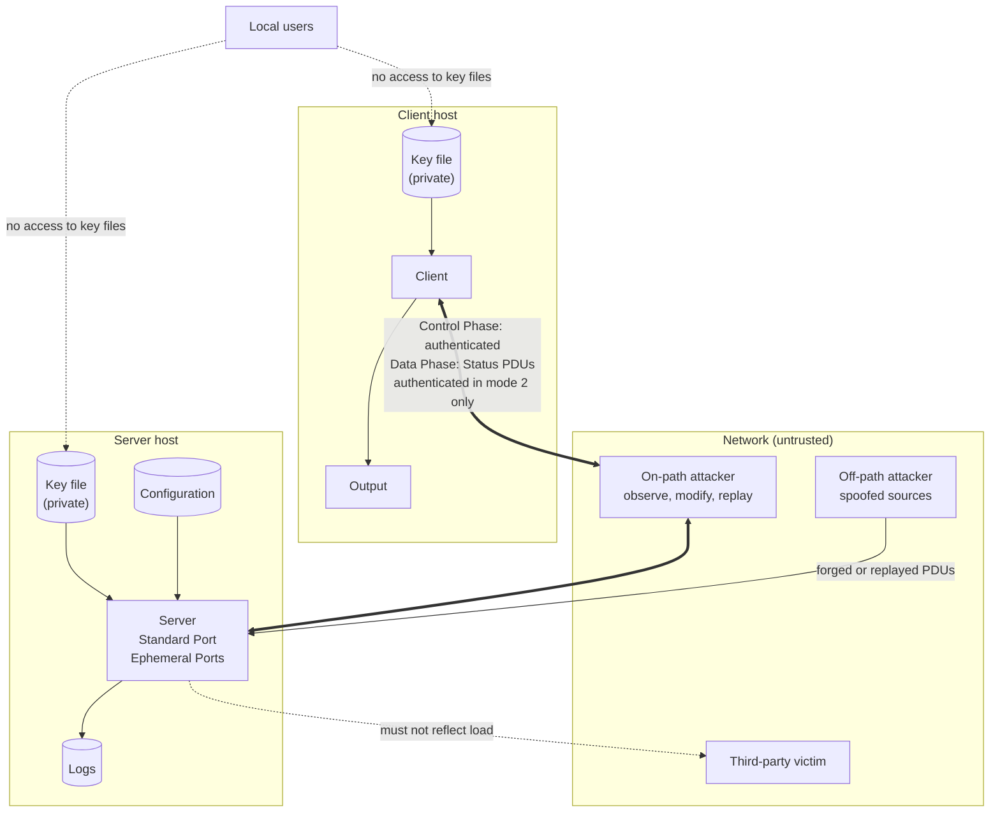

# Security model

udpstp starts a Test only for a Client that proves it holds a Shared Key the Server knows, and the Server limits how many Tests and Test Connections it carries. Server administrators and Operators deciding whether to deploy udpstp, and security reviewers, will find what it protects, from whom, and how. [SECURITY.md](../SECURITY.md) says how to report a vulnerability.

Each defence below names the file, and the function, that implements it. The [glossary](../GLOSSARY.md) defines terms such as Test Connection, Shared Key and Silent Rejection.

## Summary

- A Client selects authorized Server destinations locally before receiving responses. By default only its selected Server endpoint is accepted; authenticated Tests may use explicit per-Server alternate IP addresses through `--allow-server-address SERVER=IP`. Response authentication and Null Requests cannot add destination addresses. The sans-IO core enforces this before Activation and the Data Phase (`crates/udpstp-core/src/client.rs`, `setup_source_authorized`), retaining the selected Standard Port and IPv6 scope.
- A Test starts only after the Client proves it holds a Shared Key that the Server knows. By default the Server answers nothing to a request that fails verification (Silent Rejection).
- Only Clients authenticated with an Operator Key may run Fixed-Rate Tests.
- A Test marks its traffic only with a DSCP the Server allows: 0 (best effort) unless the administrator adds more (`allowed_dscp`), so a Consumer can't put a Test's load into a priority class, and for Operator Keys any but network control, CS6 and CS7 (`operator_allowed_dscp`). A Client refuses a DSCP it didn't ask for other than 0 (`crates/udpstp-core/src/parameters.rs`, `clamp` and `unrunnable`).
- Keys come only from key files. Unix refuses unsafe ownership or group/other reading and writing. Windows refuses supported-policy mismatches and unverified permissions before reading keys, with distinct key file errors ([Key handling](#key-handling)). Keys never appear on the command line, in errors or in output, and they are wiped from memory when no longer needed.
- UDPSTP authenticates. It does not encrypt. Anyone on the path can read Test parameters and results.
- The Server enforces Admission limits (Test Connection caps, the Admitted Rate Cap, one Test per Source), drops replays inside the time window and budgets unverified Setup Requests globally and authentic ones per Source. A key holder can still sign requests from other addresses, spending those Sources' budgets, so share keys only with Clients you trust. See [Hardening](#hardening-for-server-administrators).

## Assets

| Asset | Why it matters |
|---|---|
| Shared Keys and Operator Keys | Holding a Shared Key lets anyone start Tests. Holding an Operator Key also allows Fixed-Rate Tests. |
| Derived Keys | Anyone holding a Test Connection's Derived Keys can forge its Control Phase PDUs, and its Status PDUs in mode 2. |
| The Server's capacity | Link bandwidth, Ephemeral Ports, sockets, CPU and Admission state. All of these are finite. |
| Third parties' networks | A Load Sender can put up to multi-gigabit load on a path. It must never be steered at a victim or across a shared path that nobody agreed to test. |
| The integrity of results | A forged Status PDU can bias the Load Rate Adjustment Algorithm and therefore the reported Maximum IP-Layer Capacity. A forged Load PDU can add up to 1024 losses, which can keep Sub-Intervals from meeting the Performance Criterion; the Highest IP-Layer Capacity is reported next to it. |
| Logs | Logs record Client addresses (personal data in many jurisdictions) and use disk space that an attacker could fill. |

## Actors and trust boundaries

- **Consumer**: a Client user without an Operator Key: an ordinary Shared Key, or none where the Server allows Unauthenticated Mode. Trusted to run Tests, not trusted with Fixed-Rate Tests or unlimited resources.
- **Operator**: holds an Operator Key, and is trusted with Fixed-Rate Tests and longer Tests.
- **Server administrator**: controls the Server host, its key file and its configuration. Fully trusted.
- **Off-path attacker**: can send datagrams with any source address but cannot see the traffic between Client and Server.
- **On-path attacker**: can observe, drop, delay, modify, replay and inject datagrams between Client and Server.
- **Local user**: an unprivileged account on the Client or Server host.


<!-- description: The trust boundaries. On the Client host the Client reads its private key file and writes its output. On the Server host the Server reads its key file and configuration and writes its logs. Local users have no access to the key files. Between the hosts, the untrusted network holds an on-path attacker, who can observe, modify and replay the Control Phase, which is authenticated, and the Data Phase, whose Status PDUs are authenticated in mode 2 only; an off-path attacker, who sends forged or replayed PDUs from spoofed sources; and third-party victims, at whom the Server must never reflect load. -->

The boundaries are the network (everything arriving on a socket is untrusted until verified), the key files (readable only by the account running udpstp, which udpstp checks on every platform, see [Key handling](#key-handling)), and the logs, which can contain attacker-controlled data such as source addresses.

Assumptions: the hosts themselves are not compromised, Shared Keys are distributed over a secure channel outside UDPSTP, and both ends' wall clocks are within 5 seconds of true time.

## Threats and defences

**Load PDU timestamp gaps are bounded.** A Load Receiver's sender estimate closes at most the negotiated Test Interval's number of st plus one per Load PDU, then skips any remaining empty intervals in one step (`crates/udpstp-core/src/data_phase.rs`, `SentEstimate::add`). A Consumer can negotiate at most 60 s with st of at least 5 ms, so at most 12,001 closures are needed, independent of the wire timestamp gap. Operator Keys may permit longer Test Intervals and correspondingly larger reporting limits. This bounds the core callback's interval processing without changing the Engine Thread model (ADR 0008) or send catch-up budget (ADR 0012); it is not a measured latency guarantee.

RFC references are to RFC 9946 unless stated otherwise. Code paths are relative to the repository root.

| Threat | Attacker | Defence | RFC basis | Implemented in |
|---|---|---|---|---|
| Forged Setup Request | Off-path | Mode 1: the Client signs the request with a Client Authentication Key derived from the Shared Key and the request's own authUnixTime. The Server verifies the HMAC-SHA-256 over the bytes as received, in constant time, and answers a failure with Silent Rejection. | §5.3.1, §5.4.1, §6.2; ADR 0001, 0009 | `crates/udpstp-core/src/server.rs` (`authenticate_setup`), `crates/udpstp-wire/src/auth.rs` (`verify_received`) |
| Forged Setup or Activation Response | Off-path, on-path | The Client verifies each response with the Server Authentication Key and the time window. It accepts responses only from the Server's address or the Ephemeral Port, and ignores a response that fails verification rather than ending the Test. | §5.3.1, §6.3, §7.3; ADR 0009 | `crates/udpstp-core/src/client.rs` (`response_ignore_reason`, `handle_datagram`) |
| Forged Activation Request | Off-path | The request must carry the Setup's authMode and keyId and verify with that Test Connection's Client Authentication Key. Each Test Connection is activated at most once. | §6.2, §7.2; ADR 0009 | `crates/udpstp-core/src/server.rs` (`verify_activation`, `handle_activation_request`) |
| Replay of a Setup or Activation Request after the time window | On-path | authUnixTime must be within ±5 s of the receiver's clock. | §5.3.1; ADR 0009 | `crates/udpstp-core/src/keys.rs` (`auth_time_acceptable`) |
| Replay within the time window, including onto sibling Test Connections | On-path | A replay cache keyed on keyId and authDigest, shared by the Standard Port and every Ephemeral Port, remembering each verified request for 11 s once it is within its Source's budget, so a key holder's flood can't fill it (its size follows the global budget); Activation Requests are keyed on their sender too, since a Multi-Connection Test's can be identical, and must come from the Client's IP address. A copy spoofed from another port of the Client's address can still activate a sibling first. Unauthenticated Mode has no replay protection. | §5.3.1 | `crates/udpstp-core/src/replay.rs`, `server.rs` |
| Reflection: a spoofed source makes the Server send to a victim | Off-path | Requests that fail verification get no reply. A verified Setup Request yields a Setup Response and a Null Request, as the RFC requires: 104 bytes for 56, which the per-Source budget limits. Once a Source's budget runs out, the Server answers only its first refusal. Load PDUs are sent only after a verified Activation Request from the Client's IP address, and a Load Sender stops within 1 s when Status PDUs stop arriving. | §5.1 items 8-9, §5.3.1, §11 item 2 | `crates/udpstp-core/src/server.rs`, `replay.rs`, `budget.rs`, `data_phase.rs` (`RECEIVE_TIMEOUT`) |
| Amplification using multicast or broadcast addresses | Off-path | Setup Requests and Responses from or to a multicast address, or 255.255.255.255, are discarded silently, IPv4-mapped forms included, and so are Activation Requests from one. The Client refuses such a Server address. A subnet's directed broadcast address can't be recognised without its prefix length. The Server checks where each datagram arrived, and so does the Client on Linux and macOS; a Windows Client checks sources only (ADR 0007). | §6 | `crates/udpstp-core/src/io.rs` (`is_multicast_or_broadcast`), `server.rs`, `client.rs` |
| Flood of unverified Setup Requests (CPU) | Off-path | A request with an unknown keyId, or a key outside its accept lifetime, is discarded before any cryptography, through an indexed lookup. A global budget (`unverified_setups_per_second`, 20000 by default) limits the requests that reach a KDF run and an HMAC; the rest are dropped silently. Derived Keys are cached, so a flood sharing them costs one HMAC per PDU. See [Admission under load](#admission-under-load). | §11 item 4 | `crates/udpstp-core/src/budget.rs`, `server.rs`, `keys.rs` (`KeyTable::accepting`) |
| Exhaustion of Ephemeral Ports, sockets and bandwidth | Key holder, replayer | A global and a per-Test cap on Test Connections, the Admitted Rate Cap (CAPEXC), one Test per Source by default, per-Source and per-key budgets charged after the HMAC, a separate share for Unactivated Test Connections with eviction by key, a pre-Activation Watchdog, optional Quotas, and Admission released on every exit path, an engine panic included. See [Admission under load](#admission-under-load). | §4.2, §11 items 4-6 | `crates/udpstp-core/src/server.rs` (`admission_refusal`, `eviction_candidate`, `handle_socket_closed`, `handle_timeout`), `budget.rs`, `quota.rs`, `data_phase.rs`; `crates/udpstp/tests/faults.rs` |
| Hijacking a Test Connection | Off-path | In the Data Phase, the Data Phase Engine accepts datagrams only from the Test Connection's peer address and port. Before Activation, the Ephemeral Port accepts only the Client's IP address, and then locks to the address of the first authenticated Activation Request. | — | `crates/udpstp-runtime/src/socket/mod.rs` (`Socket::receive`) |
| Forged Status PDUs steering the rate | On-path | Mode 2 authenticates Status PDUs. Stale spduSeqNo values are excluded from rate decisions and can't deliver STOP. A Client executing a Server's Sending Rate Structure zeroes fields beyond fixed sanity limits. The Server stops an Upstream Client that sends over 1.5 times the highest rate it assigned in the last second for 3 Trial Intervals. | §5.3.2, §8.1, §8.2 | `crates/udpstp-core/src/data_phase.rs` (`handle_pdu`, `status_authentic`, `sanitize`, `police`) |
| Forged Load PDUs hiding loss | Off-path with the Test Connection's addresses, on-path | Load PDUs are never authenticated. A jump of more than 1024 in lpduSeqNo (a first Load PDU more than 1024 from 1) counts only once the next Load PDU continues from it, otherwise it is ignored; and 32 out-of-order Load PDUs received in a consecutive run more than 1024 behind bring counting back to them. So one forged Load PDU can move counting at most 1024 ahead, and two forged in a row hide loss until 32 genuine Load PDUs arrive in a row, which heavy loss can delay. Forged Load PDUs can still add loss (up to 2^31 for a confirmed jump), and forged out-of-order ones can cancel loss one for one. Only Load PDU authentication would stop that, and RFC 9946 has none. | §8.2 | `crates/udpstp-core/src/data_phase.rs` (`Lookback`) |
| Forged STOP set or cleared | On-path | Clearing STOP cannot extend a Test: each end stops on its own Test Interval timer. Setting STOP ends the Test early, which the RFC accepts as an annoyance only. In mode 2 a forged Status PDU is ignored, and a replayed one is stale, so neither delivers STOP; but in a Downstream Test the Server's STOP travels in Load PDUs, which no mode authenticates, so a forged one still ends the Test. | §11 | `crates/udpstp-core/src/data_phase.rs`, proved by `crates/udpstp-core/tests/stop_exchange.rs` and `mode2_status.rs` |
| Downgrade from mode 2 to mode 1, or to Unauthenticated Mode | On-path | authMode is covered by the digest. A mode 1 Client ignores responses carrying another authMode. The Server refuses authMode 0 unless configured to accept it. An Activation Request must repeat its Setup's authMode. The Client defaults to mode 2 and never falls back to mode 1 on its own. | §5.3, §6.2 | `crates/udpstp-core/src/client.rs` (`response_ignore_reason`), `crates/udpstp-core/src/server.rs` (`handle_setup_request`, `verify_activation`) |
| Consumers running Fixed-Rate Tests | Consumer | A Fixed-Rate request authenticated with anything other than an Operator Key is rejected with BADPARAM, and no load is sent. | §4.1 | `crates/udpstp-core/src/server.rs` (`is_fixed_rate`), proved by `crates/udpstp-core/tests/fixed_rate.rs` |
| Consumers running long or fast Tests | Consumer | The Test Interval is capped at 60 s, or at an Operator Key's own maximum, and slowAdjThresh × trialInt at 500 ms except for Operator Keys. A search without an Operator Key starts no higher than `max_start_row` (row 100 by default: from the gigabit row Algorithm B would drain one row a Trial Interval, flooding a slow link for the whole Test), and the algorithm never exceeds the Client's maxBandwidth. | §4.2, §5.1 items 4-5, §7.2.1, §10, §11 items 5-6 | `crates/udpstp-core/src/parameters.rs` (`clamp`, `Allowance`), `server.rs` (`max_start_row`) |
| Key leak through the command line | Local user | There is no option that takes a key. Keys come only from key files. | — | `crates/udpstp/src/main.rs`, proved by `crates/udpstp/tests/key_files.rs` |
| Key leak through file permissions | Local user | Unix refuses unsafe ownership and group/other content access. Windows assesses the same opened file against a bounded private-file policy and refuses mismatches or unverified permissions before reading content. | ADR 0015 | `crates/udpstp/src/keyfile.rs`, `crates/udpstp-key-permissions` ([Key handling](#key-handling)) |
| Key leak through memory | Crash dump, swap | Shared Keys, Derived Keys, HMAC state and the key file's bytes are zeroed when freed. | — | `crates/udpstp-wire/src/auth.rs` (`SharedKey`, `DerivedKeys`), `crates/udpstp/src/keyfile.rs` (`load`) |
| Key leak through logs and errors | Log readers | Key types print as `<redacted>`. Key file errors give the file, the line and the fault, never the value. | — | `crates/udpstp-wire/src/auth.rs`, `crates/udpstp/src/keyfile.rs` (`toml_error_message`), proved by `crates/udpstp/tests/key_files.rs` |
| Clock skew | Misconfiguration | A ±5 s window, both edges inclusive, checked on requests and responses and computed modulo 2^32 so that it survives the 2106 wraparound. There is no extra grace period. | §5.3.1; ADR 0009, 0010 | `crates/udpstp-core/src/keys.rs` (`auth_time_acceptable`) |
| Memory-unsafe parsing | Anyone | Protocol decoders and the Server core forbid `unsafe` and are fuzzed. Windows permission decoding and policy also forbid it; only the bounded native inspection adapter permits it (ADR 0015). | — | Workspace forbid lint; `udpstp-key-permissions` denies it except `src/native.rs`; decoder bounds use safe slices. |
| Log flooding | Off-path | Nothing is logged per PDU. Notices an attacker can trigger (dropped or refused requests, socket errors, invalid PDUs and their like) are logged ten of a kind every 10 s at most; the rest are counted and the count logged when the window ends. | — | `crates/udpstp/src/log.rs` (`Limiter`) |

## Admission under load

The Server bounds what a flood can cost it, and shares its capacity between keys. The settings below are in [Server configuration](../crates/udpstp/src/config.rs).

**Forged Setup Requests.** A request with an unknown keyId costs almost nothing to drop. One with a known keyId spends the global budget for unverified Setup Requests, `unverified_setups_per_second`, before its KDF run and HMAC. At the default of 20000 a second, this checking takes at most about 6% of one core on a 2017 laptop CPU, or 14% with the CPU held at its base clock. Beyond the budget, requests are dropped silently, and a forged flood crowds out Clients' Setup Requests until it stops. Lower the budget on a slower host.

**A key holder's flood.** Authentic Setup Requests reach Admission, which costs far more. Each Key Table row has its own budget, `key_setup_burst` and `key_setups_per_second` (1000 a second by default), and Unauthenticated Mode counts as one row. Requests beyond it are dropped after their HMAC, so one key can't make the Server fall behind, though floods on many keys together still can.

**Unactivated Test Connections** have a share of their own, `max_unactivated_test_connections`, by default half of `max_test_connections` and at least `test_connections_per_test`. When the share is full, the Server closes the oldest Unactivated Test Connection of the key holding the most. So a flood on one key evicts its own, and other keys' Clients keep their place until they activate. This is a fair share, not a guarantee:

- A key's flood keeps out that key's own Clients whose round trip is longer than the time the flood takes to fill the share. At the key's default budget, that is Clients about 128 ms or more away.
- A flood split over several keys takes a share from every key that holds more than its part.
- Raising the share, for example to 256, needs more keys to displace another key's Test, at the cost of more sockets and memory, and at least 512 Ephemeral Ports with the default cap.

To spot a flood, watch `key_id` on `TestConnectionAdmitted` and `unactivated_test_connections_evicted` in `Statistics`. Remove or expire a key that floods, then restart the Server.

**Places for activated Tests.** A Test's first activation reserves places in `max_test_connections` for all its Test Connections. If they no longer fit, the whole Test is refused, so no Test starts with only part of its Test Connections. Activated Tests can fill the cap, but a Setup flood that never activates can't.

**The Admitted Rate Cap** counts the maxBandwidth each Test states, in each direction, from its first activation to its end, whatever it sends. Set `require_max_bandwidth` with it, so that every Test counts. One Test without an Operator Key may state at most `max_test_share` of the cap, half by default.

## Key handling

**Formats.** A key file whose name ends in `.toml` is a TOML Key Table. Any other file is read as an OB-UDPST `udpst.keys` file (`crates/udpstp/src/keyfile.rs`).

- **TOML Key Table**: one `[[key]]` row per Shared Key, with RFC 7210's fields.
  - `admin_key_name` (unique) and `key_id` (the keyId, 0-255).
  - Optional `kdf` and `alg_id`. Both must be `HMAC-SHA-256` if present.
  - Exactly one of `key_text` (used as its UTF-8 bytes) or `key_hex`.
  - Optional send and accept lifetimes in `YYYYMMDDHHMMSSZ` form.
  - Optional `operator` and `max_test_interval`, an extension to RFC 7210 (ADR 0010).
  - Unknown fields, empty keys and malformed values are errors.
- **OB-UDPST files**: `<keyId>,<key>` lines, with keys of up to 64 bytes. These files have no lifetimes, so their rows are always valid.

The Shared Key is used as raw bytes and never cut at a zero byte (ADR 0001). udpstp sets no minimum key length. Use at least 32 random bytes, for example `key_hex` from `openssl rand -hex 32`.

**Permission check.** On Unix, the file must be a regular file with no group or other permission bits for reading or writing (mode `0600` or stricter), owned by the user running udpstp or by root. On every platform it must be at most 1 MiB. Otherwise udpstp exits with a key file error. Running udpstp setuid is not supported. The directory holding the file isn't checked: keep it writable only by its owner.

Windows applies [ADR 0015](adr/0015-windows-shared-key-private-file-policy.md) to every Shared Key file loaded by either role, in either format (Conformance Record `key-file-private`). It trusts only the running process account, SYSTEM and built-in Administrators, comparing binary SIDs without group expansion. Files that meet the supported local-NTFS policy proceed quietly. Dangerous grants to outsiders, untrusted ownership and absent/null DACLs are policy mismatches; unsupported storage, rights, flags or ACE types, malformed descriptors and inspection failures are unverified. Unsupported data takes precedence over a mismatch. Both are refused before content is read, with exit status 51 and distinct diagnostics naming the file, reason and remediation, without claiming effective exposure. Client errors use stderr with no JSON result; Server errors reach stderr and any configured startup log as `StartupError`. Read and parse errors retain their existing handling. Ordinary `--print-config` validates keys too. Its `--settings-only` modifier previews settings without opening keys, logs or listeners and establishes no key readiness.

Native inspection and content reading use the same handle with read-only sharing. The adapter owns its initialized, aligned descriptor buffers and temporary token handle, bounds descriptor size to 128 KiB and ACE count to 1,024, and returns owned data. Only `udpstp-key-permissions/src/native.rs` permits own `unsafe`; descriptor decoding, application policy, protocol core and network runtime forbid it. Ordinary content writers and replacement opens conflict with the reader, but ACL changes remain possible. The assessment does not determine universal effective access, freeze permissions, protect writable containing storage, handle impersonation or cover remote/non-NTFS storage. Runtime PowerShell and unmaintained ACL wrappers remain rejected.

Use the [manual reconstruction](guides/windows.md#key-file-permissions) for a dedicated profile folder, or the service installer for unattended hosting. The procedure removes pre-existing explicit grants and examines the actual file, not only its parent. Copy files into protected storage rather than moving them with their old permissions, then reconstruct their ACLs. Never keep them under a folder created directly under `C:\`, where ordinary accounts can modify the containing storage.

**Zeroization.** `SharedKey` and `DerivedKeys` wipe their bytes when freed, and so do the KDF's intermediate blocks and the buffer the key file is read into (`zeroize`, and the `hmac` crate's `zeroize` feature). That buffer is sized once and never reallocated, and a file that grows while it is read is refused. Limits:

- Copies made inside the TOML parser are beyond udpstp's reach.
- Keys are not locked in memory, so they can reach swap.
- A core dump taken while the process runs can contain the Key Table.

Disable core dumps for the service.

**Operator Keys.** A Server Key Table row marked `operator = true` is an Operator Key. Privileges come from the row that verified the Setup Request, not from anything the Client claims. An Operator Key may carry its own `max_test_interval` for Tests longer than 60 s. Give Operator Keys their own keyIds, and never share them with Consumers.

**Lifetimes and rollover** (ADR 0010, `crates/udpstp-core/src/keys.rs`):

- The Server accepts a keyId only through a row whose accept lifetime includes the Server's clock. The Client sends with the valid row that has the newest send lifetime start. If several rows are equally new, the Client refuses to guess, and `--key-id` must pick one.
- Two rows may share a keyId only if neither their send nor their accept lifetimes overlap. The Key Table is refused at start-up otherwise.
- A Test Connection keeps its Derived Keys when its row expires mid-Test.
- For a smooth rotation, give the new key a new keyId whose lifetimes overlap the old one's, then retire the old keyId.
- The key file is read once at start-up. Adding rows in advance, with future lifetimes, avoids restarts.

## Authentication Modes and Unauthenticated Mode

**Mode 1** authenticates the Control Phase: the Setup and Activation exchanges in both directions, and the Null Request.

- It proves that the peer holds the Shared Key, protects every Control Phase field from modification, and rejects replays older than ±5 s.
- It does not authenticate Load PDUs or Status PDUs, so an on-path attacker can forge Data Phase traffic.
- It does not cover IP addresses or ports.
- It detects a replay inside the window only on the Server that saw the request, with its replay cache.
- All Consumers who share one Shared Key look the same to the Server.

**Mode 2** adds authentication of every Status PDU, in both Test directions. It protects the rate decisions and the STOP signal carried in Status PDUs. Load PDUs are never authenticated, by design of the RFC. The Status PDU's sender signs it with its own Derived Key, the Client's in a Downstream Test and the Server's in an Upstream one; the receiver checks authMode, keyId, the digest and the time window, and ignores one that fails, so its Watchdog ends the Test if they keep failing (`crates/udpstp-core/src/data_phase.rs`). The Client uses mode 2 by default and never falls back to mode 1 on its own, so an attacker can't downgrade a Test; mode 1 is chosen with `--auth-mode 1`, or for one Server with `--mode-1-server`. A Server that rejects mode 2 with an AUTHINV it can't sign, as OB-UDPST does, is reported as probably not supporting it (`Event::AuthMode2Unsupported`). Two limits remain. A replayed Status PDU, stale but authentic, still counts as heard, so an on-path attacker who drops the genuine ones can keep the Load Sender sending blind for a few seconds more before its Watchdog ends the Test. And a Status PDU names no Test Connection, so two Test Connections whose Derived Keys match (the same key and the same Setup second, as in a Multi-Connection Test) accept each other's Status PDUs: an on-path attacker can move one's into the other. Both follow from RFC 9946's design.

**Unauthenticated Mode** is OB-UDPST's authMode 0. RFC 9946 does not define it: IANA lists the value as "Not used". udpstp offers it only so that it can interoperate with default OB-UDPST installations, and only when both ends opt in: `udpstp client --unauthenticated`, and `allow_unauthenticated = true` (or `--allow-unauthenticated`) on the Server. A Server that allows it still accepts mode 1. Unauthenticated Mode protects nothing. Anyone who can send a datagram to the Server can start a Test, parameters and results can be forged, and there is no replay protection. Its requests spend no per-Source budget, and every coded rejection goes to the claimed source address, so a spoofed request makes the Server answer a victim, bounded only by the global budget for unverified Setup Requests. Beyond that and the Test Connection caps, Unauthenticated Mode has no defence. Enable it only on networks where every host is trusted.

**Silent Rejection and Troubleshooting Mode.** By default, authentication failures get no reply, so a prober learns nothing. Troubleshooting Mode (`troubleshooting = true`, or `--troubleshooting`) answers them with an unsigned Setup Response carrying AUTHREQ, AUTHNC, AUTHINV, AUTHFAIL or AUTHTIME, for debugging. AUTHTIME, whose digest is valid, is signed. It is off by default, and while it is on the Server warns at startup and every minute (`Event::TroubleshootingModeOn`). It answers at most 10 failures a second. An unknown keyId and a wrong digest both get AUTHFAIL, but anyone can learn whether keys are configured (AUTHNC) and unauthenticated Tests allowed (AUTHREQ), and a spoofed request gets its reply, so turn it off after debugging. Activation Requests that fail verification stay silent even then: a Test Connection whose Setup was authentic rarely fails there.

## Out of scope

- **Confidentiality.** UDPSTP does not encrypt. An observer on the path sees addresses, keyIds, Test parameters, Status PDU contents and so the results. Use a VPN or a private network if this matters.
- **Key distribution and identity.** How Shared Keys reach Clients is outside RFC 9946 (§5.4), and outside udpstp. A keyId identifies a key, not a person.
- **An on-path attacker who drops or delays traffic.** Such an attacker can always prevent a Test or lower its result. A capacity measurement reports what the path delivers, including the attacker's interference.
- **Volumetric floods at the Server's link.** Traffic that saturates the link before it reaches the host needs upstream filtering.
- **Compromised hosts.** An attacker with root, or with the service account, can read keys and change results.
- **A key's holders against each other.** All Clients sharing a Shared Key look the same to the Server, and so does everyone where Unauthenticated Mode is on. A key holder's flood can keep that key's own distant Clients from starting Tests, and a flood split over several keys takes a share from every key. No defence finer than the key is possible. [Admission under load](#admission-under-load) explains the limits.
- **Consent of the measured path.** RFC 9946 §11 requires cooperating hosts. udpstp enforces this through key possession, and Server administrators decide who receives keys. Quotas of Tests and load bytes are optional.

## Hardening for Server administrators

1. **Keep authentication on.** Leave `allow_unauthenticated` off (the default) on any Server that is reachable from networks you don't control.
2. **Limit who can reach the Server.** Allow-list Client networks in your firewall where you can. Give each population of Clients its own key, and keys only to Clients you trust. [Admission under load](#admission-under-load) explains what the Server's own limits hold back.
3. **Protect the key file.** On Linux and macOS, keep it owned by the service account with mode `0600`. On Windows, udpstp refuses a file that other accounts can access; set it up as [udpstp on Windows](guides/windows.md#key-file-permissions) shows. Use random keys of at least 32 bytes, a separate key per population of Clients, and separate Operator Keys. Use lifetimes to plan rotations.
4. **Open only what is needed.** A stateful firewall needs only the Standard Port (24601) open inbound: the Null Request the Server sends from each new Ephemeral Port lets that Test Connection's traffic back in (tested with nftables). A stateless filter, a NAT and Windows Defender Firewall need the Ephemeral Port range too, 49152-65535 by default. Narrow it with `ephemeral_ports` so that the rule stays small. [Open the firewall](guides/hosting-a-server.md#open-the-firewall) has the details.
5. **Run unprivileged.** The Standard Port is above 1024, so the Server needs no root privileges or capabilities. Run it under a dedicated account with core dumps disabled (for example `ulimit -c 0`).
6. **Synchronise clocks.** Run NTP or similar. Clocks more than 5 s apart make every authenticated Test fail.
7. **Handle the logs.** The Server logs its events to standard output, human-readable or as JSON (`log_format`), including discarded requests and full Client addresses; startup warnings go to standard error. Events an attacker can cause are limited to ten of a kind and a hundred in all every 10 s, the rest counted. Every `statistics_interval` (60 s by default) a `Statistics` event gives the counters since start: Tests and Test Connections admitted, those active, refusals and drops by reason, authentication failures, rate-limited Setup Requests and stale Status PDUs; each Test ends with a `TestSummary` of its Client address, keyId, direction, parameters, bytes and result, limited like the events above when none of its Test Connections was activated. Send the output to a log system that rotates it, and treat it as personal data. `address_privacy` shows Client addresses in full (the default, for abuse handling), pseudonymized (`anon-` and 8 bytes of HMAC-SHA-256 over the IP address, keyed with the hex key in `address_privacy_key_file`, so one Client keeps one pseudonym while the key is kept) or truncated to the IPv4 /24 or IPv6 /48.
8. **Use the hardened unit or the container image.** [`contrib/systemd/udpstp-server.service`](../contrib/systemd/udpstp-server.service) runs the Server as a user systemd creates when it starts, with no capabilities, a read-only view of the system, UDP and the journal's socket only, a system call filter and core dumps off, and passes it the Key Table as a credential; `scripts/systemd-check.sh` checks it with `systemd-analyze verify` and `security`. [`contrib/container/Containerfile`](../contrib/container/Containerfile) builds an image with no shell that runs the Server as uid 65532. [Run it as a service](guides/hosting-a-server.md#run-it-as-a-service) has the details.

## Verify a release's build provenance

Release checksums detect a download that differs from the published hash. Build attestations add a separate, signed check of where it was built. The install scripts don't perform this check.

Use the [GitHub CLI](https://cli.github.com/) 2.97.0 or later, signed in with `gh auth login`. Download the archive yourself, since the install scripts delete theirs. For Linux on x86_64:

```sh
tag=v0.1.0
archive=udpstp-$tag-x86_64-unknown-linux-gnu.tar.gz
gh release download "$tag" --repo pederbe/udpstp --pattern "$archive"
gh attestation verify "$archive" --repo pederbe/udpstp \
  --signer-workflow pederbe/udpstp/.github/workflows/release.yml \
  --source-ref "refs/tags/$tag"
```

For Windows, in PowerShell:

```powershell
$tag = 'v0.1.0'
$archive = "udpstp-$tag-x86_64-pc-windows-msvc.zip"
gh release download $tag --repo pederbe/udpstp --pattern $archive
gh attestation verify $archive --repo pederbe/udpstp --signer-workflow pederbe/udpstp/.github/workflows/release.yml --source-ref "refs/tags/$tag"
```

Use your release's tag and archive name, and continue only if verification succeeds. This checks the signed provenance against the repository, the Release workflow and the source tag. It doesn't prove the code is safe or stop a tag from moving. [GitHub's attestation guide](https://docs.github.com/en/actions/concepts/security/artifact-attestations) explains the guarantees.
