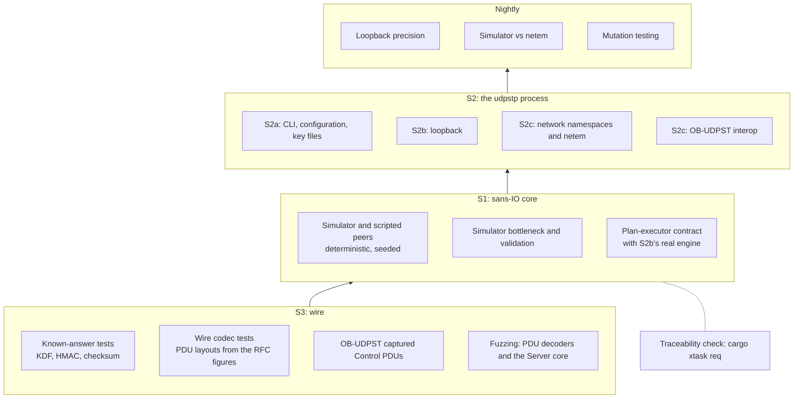

# Testing

How udpstp is verified: the principles, the test tiers that exist and those planned, how to run each one, and where a new test goes. The [specification](spec.md#testing-decisions) records the testing decisions. [GLOSSARY.md](../GLOSSARY.md) defines the terms used here.

## Principles

Static benchmark workspace regressions in `crates/bench-rounds/tests/host.rs` use isolated filesystems and stand-in SSH programs. They cover refused existing entries, unsafe parents, replacement and missing directories, command and copy guards, shared-host roles, preflight transitions, interruption during allocation and ownership-scoped Round Teardown. Intentional binary retention and key removal are checked on both routes.

**Test behaviour at a seam.** A test checks what is observable at a documented seam: PDUs on the wire, wire bytes, events, process output and exit codes. It never checks internal state or arbitrary private helpers, so tests survive refactoring. A core module listed [below](#core-modules-tested-at-their-own-interface-s1) is a seam of its own, as are the explicitly named internal [presentation and site-generation interfaces](#presentation-and-site-generation). These interfaces may remain private. The spec names the seams, and the tickets refer to them:

| Seam | What is tested | Where |
|---|---|---|
| S1 | The sans-IO core, through a test harness, and its listed modules at their own interface | `crates/udpstp-core/tests/`, and in-crate for those modules |
| S2a | The `udpstp` process with no network | `crates/udpstp/tests/cli.rs`, `key_files.rs` |
| S2b | The `udpstp` process over loopback sockets | `crates/udpstp/tests/loopback.rs` |
| S2c | The `udpstp` process through network namespaces (Linux), and interop | `crates/udpstp/tests/netns.rs` |
| S3 | Wire known-answer tests, and fuzzing | `crates/udpstp-wire/tests/`, `fuzz/` |

ADR 0015's Windows permission boundary has safe descriptor/policy tests in
`udpstp-key-permissions`, and native file/process tests in
`crates/udpstp/tests/windows_key_permissions.rs`. The finite matrix covers
ordinary rights and inheritance, unsupported ACLs, sharing and inspection
failure; process tests cover both roles/formats, refusal status 51, absent JSON on failure, successful exit status,
Server stderr/daily logging, and replay of the documented ACL reconstruction
against an existing outsider grant. Actual virtual-service access and a second
ordinary account's denied access to its Key Table require a native service
fixture. `scripts/windows-key-service-check.ps1` also covers first-install and reinstall refusal, effective and queued recovery, failure containment and rerun after remediation. These prove startup assessment and refusal, not lasting ACL protection.

**The sans-IO core makes most tests deterministic.** `udpstp-core` holds all protocol logic but performs no I/O and reads no clock: the caller passes the time in with each call, and the core returns the datagrams to send, the sockets to open or close, its next deadline and its events. A test harness can therefore stand in for sockets and clocks. It runs a Client core and a Server core against each other on a virtual clock, with every random choice drawn from a seed. The same seed gives the same datagram trace on every OS, and a failed check prints the seed and a trace hash (FNV-1a, stable across platforms and Rust versions) so the run can be replayed exactly. Deadlines, wall-clock steps and Data Phase Engine stalls are tested in virtual time, so these tests never sleep and never flake. Only the S2 tiers touch real sockets and real time.

**Expected values come from independent sources.** A test that derives its expectation from our own code proves nothing. So wire tests write the expected bytes out by hand from the RFC's figures, scripted peers build PDUs byte by byte from the RFC text instead of using our Client or Server, and known-answer vectors come from other implementations (OpenSSL, the RFC 4231 text), each recording its provenance.

**The traceability matrix ties tests to the RFC.** Every normative statement of RFC 9946 (and of RFC 9097 as RFC 9946 uses it) is recorded as a Requirement with a stable ID and its exact RFC text, in [docs/conformance/requirements/](conformance/requirements/). A test proves Requirements by carrying their IDs in a `#[req]` tag. `cargo xtask req` checks that every quoted text is really in the RFC, that no text was edited by accident, and that every tag names a real Requirement. It derives each Requirement's status from the tags: tested, still pending, or recorded as a Deviation or Interpretation with the ADR that explains it. What it proves is that each "tested" claim is backed by a named test of a real RFC sentence. It does not prove that the test is strong enough; that is what review, independent expected values and [mutation testing](#mutation-testing) are for.

## Test tiers

Solid boxes exist today; dashed boxes are planned, with their tickets.



### Known-answer tests (S3)

The cryptography and checksum are checked against vectors from independent sources.

- **KDF:** `crates/udpstp-wire/tests/kdf_kat.rs` checks the Derived Keys against `tests/vectors/kdf-openssl.txt`, generated by OpenSSL's KBKDF configured as RFC 9946 Appendix A configures it (ADR 0001). The vectors cover authUnixTime 0 and 2³²−1, a Shared Key with zero bytes inside it and one longer than the SHA-256 block.
- **HMAC-SHA-256:** `tests/hmac_rfc4231.rs` checks the seven test cases extracted from the text of RFC 4231 into `tests/vectors/hmac-rfc4231.txt`.
- **Internet checksum:** `tests/load_pdu.rs` checks the RFC 1071 example, odd lengths and carry folding.
- **Captured OB-UDPST Control PDUs:** `tests/obudpst_control_kat.rs` checks the Setup and Activation PDUs of three OB-UDPST runs in auth mode 1 (Downstream, Upstream with a maxBandwidth, and with the header checksum), in `tests/vectors/obudpst-control.txt`: our wire layer verifies each authDigest with the Derived Keys of the same Shared Key and reproduces each PDU byte for byte, digest and checksum included, from its decoded fields. `cargo xtask capture` recaptures them on Linux from [the pinned OB-UDPST build](#the-pinned-ob-udpst-build), through a UDP relay on loopback, since capturing packets would need root. The separate upstream JSON fixtures support the [CLI compatibility tests](#cli-and-loopback-integration-tests-s2a-s2b). Their source is recorded in [provenance.md](provenance.md).

Run them with `cargo test -p udpstp-wire --test kdf_kat --test hmac_rfc4231 --test load_pdu --test obudpst_control_kat`. `cargo xtask kat` regenerates both vector files; it needs OpenSSL 3.x on `PATH` and RFC 4231 downloaded to `reference/standards/rfc4231.txt`, so CI doesn't run it. The committed vector files are what the tests read.

```rust
// RFC 1071 §3 (numerical example: bytes 00 01 f2 03 f4 f5 f6 f7 sum to
// ddf2, so the checksum, the one's complement of the sum, is 220d)
#[test]
fn internet_checksum_matches_the_rfc_1071_example() {
    let bytes = [0x00, 0x01, 0xF2, 0x03, 0xF4, 0xF5, 0xF6, 0xF7];
    assert_eq!(internet_checksum(&bytes), !0xDDF2);
}
```

### Wire codec tests (S3)

`crates/udpstp-wire/tests/` has one file per PDU (`setup_pdu.rs`, `activation_pdu.rs`, `load_pdu.rs`, `status_pdu.rs`) and `key_types.rs`, which checks that key types redact themselves in debug output. Each PDU file encodes a sample with every field set to a distinct value and compares it with bytes written out by hand from the RFC figure, decodes those bytes back, and checks that wrong sizes and pduIds are rejected. The Setup, Activation and Status PDU files also check that reserved fields are ignored on receipt, and the Load and Status PDU files what the checksum covers.

Run them with `cargo test -p udpstp-wire`.

```rust
#[udpstp_req::req("RFC9946-6.1-4", "RFC9946-6.1-13")]
#[test]
fn reserved_field_is_ignored_on_receipt() {
    let mut bytes = sample_bytes();
    bytes[53] = 0xFF; // reservedAuth1
    assert_eq!(SetupPdu::decode(&bytes), Ok(sample()));
}
```

### Core tests with the simulator harness (S1)

Response-only fixed-rate checks stop after Activation. Finite algorithm and
classification scripts use `reported_then_stopped` to end Load traffic after
their reports. Checks observing later Load PDUs, silence or watchdog expiry
keep `reported` or the timed `reported_at` helper and their observation windows.

This is the main seam and holds most of the tests. They cover the Setup, Activation and STOP exchanges, the Client's Multi-Connection Coordinator against one Server or several (`Scenario::coordinated`, `add_server`), mode 1 and the Key Table, Coercion, the Sending Rate Table, Downstream and Upstream Load PDUs, Status PDUs with Sequence Errors, and Fixed-Rate Tests. Each file in `crates/udpstp-core/tests/` covers one feature.

Tests describe a scenario through the harness in `crates/udpstp-core/tests/harness/` and never call the core API directly, so a change to the core's interface is absorbed in one place:

- `harness/mod.rs`: `Scenario`, a builder for both ends' settings and a seed, and `Outcome`, with the trace and queries such as `client_accepted_test_port()` and `server_dropped_setup_because(..)`. `Outcome::check` fails with the seed, trace hash and full trace. Settings the harness has no builder method for are patched: `server_config`, `client_config` (every Client's `ClientConfig`) and `test_plan` (the first Client's `TestPlan`).
- `harness/sim.rs`: the simulator. It plays the part of `udpstp-runtime`: it opens sockets when a core asks, delivers datagrams, calls each core at its deadline, and runs each Test Connection's Send Plans the way a Data Phase Engine does. By default its network is lossless and zero-delay. On request it adds a path delay with jitter and a drop-tail bottleneck, reorders or duplicates Load PDUs, clears or sets testAction, steps or slews a host's wall clock, offsets the Client's clock or makes it drift, shifts the Client's kernel receive timestamps, stalls a Data Phase Engine, or shuts the Server down (`Scenario::server_shuts_down_at`). Like the runtime, it reports a Data Phase's socket closed only when its engine exits, after the Data Phase's last event, and it fails a test whose core asks to close a socket its Data Phase still runs on. Each Client runs the Multi-Connection Coordinator, as production does: one Test Connection by default, sending from the Client's address (`CLIENT_ADDR`), more with `Scenario::coordinated`, from the ports after it; a Client added after the first runs a Test of its own. A Test a scenario spreads over several Clients, or one the Coordinator would never make (an mcIndex used twice, two directions), is played by scripted Clients (`Scenario::add_scripted_client`), since a Coordinator runs a whole Test from one host; the core exports no other Client-side endpoint.
- `harness/scripted.rs`: scripted peers, a hand-written Client or Server whose PDUs a test builds from the RFC text. These are the non-circular check for which key signs which PDU, for responses our own Server would never send, and for requests our own Client would never send, which `harness/requests.rs` builds byte by byte from RFC 9946 Figures 3 and 6.

`harness_replay.rs` tests the harness itself: the same seed replays the same trace, a failure reports the seed and trace hash, and a Client runs the Multi-Connection Coordinator from its own address.

#### Core modules tested at their own interface (S1)

A core module listed here is a seam of its own: its rules are tested at its interface, in-crate (`#[cfg(test)]`), so no public API grows (the specification). Expected values still come from independent sources: the RFCs, the spec, the ADRs and the Conformance Records, never from the code. Each rule keeps at least one harness scenario proving how it is wired into its role; harness tests that only enumerated the module's combinations were moved into the module. Scripted peers stay the independent check of which key signs which PDU and which fields are read. Everything else in the core is still tested through the harness.

| Module | Its interface | Harness scenarios proving the wiring |
|---|---|---|
| Data Phase, `crates/udpstp-core/src/data_phase.rs` | `DataPhase`: received Load PDUs, Status PDUs, deadlines and events. The sender estimate's timestamp-gap regressions also use test-only closure counts and inspect the sequence boundary carried beyond the reporting limit, where no further estimate is emitted; a work ceiling makes an unbounded loop fail deterministically | `sender_estimate.rs`, `sequence_errors.rs`, `stop_exchange.rs`, the Data Phase contract suite |
| Admission, `crates/udpstp-core/src/admission.rs` | `Admission`: judge a verified Setup in the recorded order (`setup-check-order`), open its socket, activate it, count its load bytes, close it; `drive` for the fuzz target | `admission_limits.rs`, `tests_per_source.rs`, `quotas.rs`, `unactivated_share.rs`, `test_share.rs`, `multi_connection_checks.rs`, `server_shutdown.rs` |
| A Test's measurement results, `crates/udpstp-core/src/results.rs` | `MeasurementResults`: a Test Connection's or a whole Test's Sub-Intervals, IP-Layer Sender Bit Rate, Capacity Modes and their Maximum and Highest IP-Layer Capacity, from its Data Phase events; tested on hand-built events with sums worked out by hand | `sub_interval_results.rs`, `multi_connection_aggregation.rs` |
| A Search Test's searches, `crates/udpstp-core/src/search.rs` | `SearchTest::shortfalls`: when no Test Connection's search found the path's limit, by confirming Congestion or by meeting it at its end, why each fell short of it, from its Data Phase events; tested on hand-built counts and IP-Layer Sender Bit Rates, each rule at its edge. `FixedRateTest::sending_rate_not_kept`: whether a Downstream Fixed-Rate Test's Server sent more than the same margin below its rows' sending rate where a Maximum IP-Layer Capacity was measured; tested on hand-built results at the margin's edge | `congestion_never_confirmed.rs`, simulated impairment Tests: bottlenecks confirm Congestion below the 1 Gbps row, and above it, at 2.5 and 11.8 Gbit/s behind a Server with a 9000-byte MTU, the search meets the limit at its end, while a Server that falls behind, with loss windows too, jitter, a maxBandwidth and a short Test are each named. The Fixed-Rate rule is wired into the Client's results, whose tests hold it: `a_server_that_did_not_keep_its_sending_rate_is_warned_of` and the Fixed-Rate transcripts (`crates/udpstp/src/test_results.rs`); `trial_interval_counts.rs` for the counts it reads, the last 64 Trial Intervals included |

Run them with `cargo test -p udpstp-core`, or one file with `cargo test -p udpstp-core --test stop_exchange`. A simulated run with two cores:

```rust
#[udpstp_req::req("RFC9946-6.1-1")]
#[test]
fn unauthenticated_setup_ends_in_ack_with_a_test_port_when_both_ends_opt_in() {
    let outcome = Scenario::new(1)
        .server_allows_unauthenticated()
        .client_unauthenticated()
        .run_for(Duration::from_secs(1));

    let test_port = outcome.client_accepted_test_port();
    outcome.check(test_port.is_some(), "the Client's Setup was accepted");
    outcome.check(test_port != Some(0), "the accepted testPort is non-zero");
}
```

A scripted Server answering our Client (`activation_mode1.rs`; `answer` builds a signed Activation Response with the given Command Response):

```rust
#[udpstp_req::req("RFC9946-7.3-2")]
#[test]
fn client_reports_a_signed_badparam() {
    let outcome = scripted_server(60, |request, t, now| {
        Some(answer(request, 2, now, 0, &server_key(t)))
    });

    outcome.check(
        outcome.client_activation_rejected(0),
        "the Client reported the rejection",
    );
}
```

### Presentation and site generation

The following internal interfaces are also test seams. In-crate tests supply
ordinary inputs, text, widths or captured writers and assert rendered output,
validation results or actionable errors. Expectations come from documented
behaviour or independently written fixtures. This permission does not cover
arbitrary private helpers, intermediate state or implementation tables.

| Interface | Observable contract |
|---|---|
| `terminal::{columns, wrap, log_entry, table, table_fits}` | Displayed columns, intact text, hanging continuations and aligned or labelled tables. Destination detection is tested through the process. |
| `results::render_at` | Human result text for the supplied result and width. The test-only `render` function is a convenience caller. |
| `test_results::print` | Ordered stdout/stderr output and exit status for a runtime outcome and options. |
| `log::subscriber_at` | Human or JSON events captured through the supplied writer. |
| `site::pages::assemble` | Chapter order and nesting, repository content, generated insertions and appended reference text. |
| `site::finish::{head, contents_landmark, ensure_contents_title, ensure_noindex, search_teasers}` | Generated document or script bytes and rejection of changed upstream templates. |
| `site::finish::{check_page_metadata, check_hosting_routes}` | Validation of document identity, structured data and serving URLs. |
| `site::finish::mdbook_accessibility` | Generated markup and the returned match results used by the build's guards. Their expectations are independently specified. |

Process tests and the complete site build check that these interfaces are wired
into their callers. No public Rust interface grows to support these tests.

Human color tests compare reported content with plain output after removing
styling and decorative status symbols, at 60, 80, 100 and 120 columns. They check
neutral table measurements, qualified main-result emphasis, typed outcomes,
reset spans, the RGB palette and unchanged JSON. Wide reports use one table,
narrow reports group metrics without clipping. Process tests resolve stdout and stderr
independently and exercise help before normal execution, environment precedence,
startup diagnostics and console/file destinations. Unix pseudoterminals and the
native Windows ConPTY harness test actual terminal capabilities separately from
forced-color pipe captures. The Windows harness checks terminal handles and
visible screen attributes, with bounded children and concurrent output draining;
it does not establish readability for every terminal's configurable palette.

The ignored `export_terminal_preview` and `export_server_preview` tests write
ANSI examples through these same rendering interfaces. To export wide and narrow
reports, help, an error and Server logs, run
`env UDPSTP_PREVIEW_DIR=/absolute/output/path cargo test -p udpstp --bin udpstp export_ -- --ignored`.
The directory is created if needed. Reports use fixed fixtures at 120 and 60
columns so visual comparisons do not depend on redirected output's width.

### CLI and loopback integration tests (S2a, S2b)

These run the built `udpstp` binary (`CARGO_BIN_EXE_udpstp`) as a child process and check its output and exit codes. Every child process has a deadline: most use `run_bounded` in `crates/udpstp/tests/common/mod.rs`, while the terminal tests manage their own pseudoterminal and ten-second limit. A process that runs too long is killed, so a wrong behaviour fails the test instead of hanging it.

Human layout is checked at 60, 80, 100 and 120 displayed columns. `results.rs` preserves the measurement values, separate Capacity Modes, missing results, validity, warnings and RFC 9097 reporting context in compact and wide tables, with fixtures `tests/golden/terminal-*.txt`. `test_results.rs` checks full, truncated and pseudonymized Client identities, unknown wildcard bindings, and each Maximum's own Sub-Interval result receipt time, including an aggregate's latest first report and missing timestamps. On Unix, `terminal_width.rs` runs the binary against real pseudoterminals, checks help and diagnostics at each width, and proves that stdout and stderr choose their widths independently when the other destination is a pipe. Redirected output stays at 80 columns even when `COLUMNS` says otherwise. `log.rs` checks that wrapped human Server events retain distinct continuations and that JSON records stay on single lines. These terminal tests also bound each child process to ten seconds.

- **S2a, no network:** on Windows, `cli.rs` checks that the built exe names no `vcruntime` DLL, so it runs without the Visual C++ Redistributable; the exit-status table is a table-driven test of how each Test Connection ends in `crates/udpstp/src/test_connection_end.rs`, listing every code, beside a test there that what a timed-out Test Connection says follows its code; how a Multi-Connection Test combines them is a table in `crates/udpstp/src/exit.rs`. `cli.rs` covers subcommand help, the Server's TOML configuration with command-line overrides, and exit code 50 for configuration errors. The Client's and the Server's startup warnings and configuration errors, each with its exit status, are table tests of `crates/udpstp/src/start/`: the Client's options are parsed from command lines, and the host's abilities, its socket buffers and name resolution are inputs, so the rules are checked the same way on every OS; loopback tests check that the Server's warnings reach its stderr, and that a Server that can admit no Test says so and still starts. `key_files.rs` covers TOML Key Tables and OB-UDPST `udpst.keys` files, exit code 51 for key file errors, refusal of key files readable by others, and that keys never appear in output. The text results are golden-file tests (`crates/udpstp/src/results.rs` against `crates/udpstp/tests/golden/`); `UDPSTP_BLESS=1 cargo test -p udpstp` rewrites the files after an intended change, to be reviewed in the diff. What the Client prints once a Test has run, its stdout and stderr in the order written and its exit status, is a pure function of the runtime's `TestOutcome` and the options (`crates/udpstp/src/test_results.rs`), checked as a transcript for one Test Connection and for two, as text and as JSON, completed, timed out, refused and aborted, and for what those miss: no valid Maximum IP-Layer Capacity in a second Capacity Mode, an Upstream Multi-Connection Test, a Fixed-Rate Test the Watchdog ended, an interrupted Multi-Connection Test with a socket error, a failed Data Phase Engine with the JSON's extension off, other causes of a timeout, a Search Test that never confirmed Congestion, and a Downstream Fixed-Rate Test whose Server sent well below its rows' sending rate, with one Test Connection and with two (`tests/golden/client/`). One table goes through every way a Test Connection can end, each EndReason, ClientResult, Control Phase failure and cause of a timeout, in a Test of that one Test Connection and as the first of a Multi-Connection Test's two, and two that ended alike (`test-connection-ends-*.txt`); a test pins the words the Server-scale Rounds' judging reads to tell an unanswered Activation exchange from an unanswered Setup exchange, which ADR 0013 leaves free to change. Why a Test initiation timer expired, the exchange it expired in and the last response of that exchange ignored, is the core's rule, proved against a scripted Server in `crates/udpstp-core/tests/control_timers.rs` (the held Activation Request of a Multi-Connection Test in `multi_connection_start.rs`); the binary's tests take the cause the core reports and check the exit status and what the Client says of it. The stable interfaces ([ADR 0013](adr/0013-stable-interfaces-from-0-1-0.md)) are checked the same way, structurally, never through `--help` or log text: the CLI's options, value spellings and defaults from clap's Command model (`cli.txt`), every TOML setting and default (`server-settings.toml`, `server-defaults.toml`; `crates/udpstp/src/interfaces.rs`), the log's names and each JSON log line's keys and types (`names.txt`, `log-fields.txt`), exit statuses (`exit-statuses.txt`), the Key Table's columns (`key-table-columns.txt`) and the pseudonym algorithm's known answers (`privacy.rs`). The JSON results are golden files too (`completed.json`, `bimodal.json`, `extension.json`), and are also checked against OB-UDPST's vendored examples (`testdata/obudpst-9.1.0/json_examples`): the same key paths in the same order, and a value shape OB-UDPST writes for each key (`crates/udpstp/src/json.rs`).
- **S2b, loopback:** `loopback.rs` starts a real Server on a free port and runs Clients against it. It covers the Control Phase over IPv4 and IPv6 loopback, host-name resolution, the Ephemeral Port range, the Standard Port default, the Client's time limit, a Server surviving an oversized datagram (ADR 0006), mode 1 with TOML and OB-UDPST key files, accept lifetimes, and Downstream and Upstream Fixed-Rate Tests. IPv6 tests skip themselves on hosts without IPv6 loopback. These tests prove completion, not pacing; pacing is for the plan-executor contract below and, precisely, the loopback precision suite.

The Multi-Connection loopback scenario keeps three live rounds: one-Server text
and two-Server Downstream and Upstream JSON. Both JSON rounds check observed
active counts, each Test Connection's Server and completion, and the Test's
completion. Exact text layout, per-connection headings and Upstream approximation
wording stay at the deterministic Client transcript seam described above.

The **plan-executor contract** is one set of checks, `crates/udpstp-core/tests/contract/mod.rs`, run against the simulator's executor (`crates/udpstp-core/tests/plan_executor.rs`, S1) and against the real Data Phase Engine on loopback (`crates/udpstp-runtime/src/contract_tests.rs`, S2b, which includes the file). Received Load PDUs prove every Load PDU goes once, in order, from 1, a Send Plan never goes before its slot, no more Send Plans go than slots, and the reported sent counts match what arrived, less at most the st still open. The timestamp-domain check compares lpduTime with an independent clock witness. The simulator meets it exactly, with partial sends too.

The real engine's test activates an Upstream Fixed-Rate Test in memory through the Client's Multi-Connection Coordinator and a Server core, runs the Client's Data Phase on the engine and records it with a plain socket in the Server's place. A test-only socket adapter forwards unchanged to the real socket and records the engine's supplied stamping time for successful sends against an independently captured activation wall/monotonic clock pair. Received bytes still prove ordering, spacing and counts. Their lpduTime must be within the same 20 ms tolerance of this send-domain witness. A wall-clock read after receive cannot provide that witness, because buffering or observer preemption delays it.

Periodic schedule coverage starts at the known first slot, projected with the clock pair used to activate the core, and accounts for reported Skipped Bursts as ADR 0012 permits. Unexplained missing Send Plans fail, and the live executors must produce at least two periodic Send Plans. Immediate STOP2 traffic retains sequence, timestamp and total sent-accounting checks. Regressions exercise initial skips hiding a later gap, immediate and delayed STOP2, receiver buffering, wrong timestamp offsets and epochs, backward timestamps, sequence gaps and over-reported datagram/byte counts. These checks cover timestamp domains and schedule accounting. Actual achieved rate, send latency and pacing precision remain measurements.

A known gap: the simulator's executor keeps a simpler turn than the engine's, which the contract doesn't judge. It sends every due Send Plan of a step, with no bound on how long, and reads nothing between the Send Plans of a catch-up; and it hands each datagram to its Data Phase as it arrives. The engine sends for at most 1 ms a turn and reads between the Send Plans of a catch-up (ADR 0012), and reads what arrived before it judges its timeouts, so a late turn doesn't back off for a Status PDU waiting in the socket. S1 proves none of that: the 1 ms bound is proven in the runtime by a host slower than its schedule (`fault_tests.rs`), the rest only on real sockets as a whole.

Run them with `cargo test -p udpstp`, or `cargo test -p udpstp --test loopback`.

**Windows firewall prompts during tests.** Ordinary loopback tests listen on `127.0.0.1` and, where available, `::1`; their port probes use loopback too. Tests of the default listeners, arrival addresses and port ownership still need wildcard sockets. The Server also holds a wildcard guard socket for each Ephemeral Port on Windows. Those paths can still trigger a firewall prompt for a new executable path. Choosing **Cancel** does not prevent these local loopback tests from running. Keep the same Cargo target directory between builds to avoid creating more program paths. If you also use that executable to serve other machines, follow the [Server's firewall instructions](guides/windows.md): Windows keeps Block rules after Cancel, and those rules take precedence over Allow rules ([Microsoft's rule behavior](https://learn.microsoft.com/en-us/windows/security/operating-system-security/network-security/windows-firewall/rules)).

```rust
#[test]
fn a_client_completes_the_control_phase_over_ipv4_loopback() {
    let server = Server::start(&[]);

    let output = client(&["--unauthenticated", &format!("127.0.0.1:{}", server.port)]);

    assert_activated(&output, "IPv4");
    assert!(test_port(&output).is_some_and(|p| p != server.port));
}
```

`udpstp-runtime`'s own tests check socket details, among them what each error number an OS returns means on each call that can return it, in one table per OS written out from ADR 0006 and the kernel's refusals (`socket/classify.rs`); the socket module's own rules against a scripted adapter whose calls fail as a test says, the same on every OS (`socket/tests.rs`): an ICMP error on a send reported and the send made once more, a full send buffer ending a Send Plan's sending, a datagram too large for the Path MTU counted as sent, and on Linux a refused GSO send going on without GSO from the first datagram not sent, and a refused `sendmmsg` one datagram at a time from then on, and a batch the adapter sends with a `sendmsg` call per message, as with numbered send timestamps, reported as UDP GSO without `sendmmsg`; and, on Linux, that Load PDUs sent with `sendmmsg` and UDP GSO arrive over loopback as the datagrams they were, in order (`socket/batch.rs`), and that datagrams read with `recvmmsg` arrive whole and in order, header-only with their full length, with a kernel timestamp between their send and their read and with the DSCP they were sent with, and that one whose control messages don't fit loses only its own (`socket/batch_read.rs`), and that kernel send timestamps stay matched to their Send Plans: the numbers each message carries come back from the kernel, over IPv4 and IPv6, a message it refused shifting none, and a numbered batch answers as `sendmmsg` would, with how many messages went before one the kernel refused, or with the error of one it refused first (`socket/send_stamps.rs`, skipped before Linux 6.13, where the kernel refuses them), every one of ten Send Plans is matched, each lag its own plan's, after a queue discipline's drop of a message the kernel numbered, and where the kernel numbers the messages (forced with `ts_opt_id_unsupported=1`) the count stops at that drop, and where the kernel refuses the numbers after all (EINVAL, OPT_ID turned off under the socket) a batch or a datagram goes again without them, the count stops, and the sends go on (`socket/linux.rs`); and that a socket's Receive Buffer Overflows are counted, as many as the datagrams sent to it and not read, from the process's own UDP tables, or from the count the kernel attaches to the datagrams read where the tables can't be read, the datagrams read after the first overflow keeping their timestamps and TOS from the second read on, and the count unknown while the last datagram read lost it with its control messages (`socket/overflows.rs`), also where `/proc` shows only processes, with the options the hardened systemd unit mounts it with, which since Linux 7.2 hides the tables too where its mounter lacks `CAP_NET_ADMIN` over the network namespace: in the host's network namespace (the tables on earlier kernels, the attached count since), in one of its own (the tables on every kernel, as where root mounts the `/proc`) and with the tables hidden under a tmpfs (the attached count on every kernel), each checked to count as expected (rootless, in a user, mount and PID namespace, each way skipped where the host doesn't allow it. GitHub's runners allow none when the unit tests run, before the network-namespace step lifts AppArmor's restriction, so there it skips; CI's systemd step runs the unit itself and checks its log); the loopback tests exercise it through the binary, and on Linux check that at a row whose Bursts end with an Add-on every Load PDU arrives whole, in order and once, that the Load Receiver counted, header-only reads and all, what the Load Sender sent, which was no more than the row's rate (a full-size Add-on would be more), and that the results name the fast paths used. None of that depends on the host keeping the row's schedule; whether it does is the precision suite's to check.

Which reading of the clock each core call of a Test Connection slot gets is pinned over a scripted clock, whose every reading is logged, and a recording of the slot's Data Phase, which logs each call that takes the time with the reading it got, on a scripted wire (`engine/slot_tests.rs`): in a `Turn`, one pair as the turn starts, a fresh read of the Test Time Base alone before a slot's first `poll_burst`, before each Send Plan's `write_datagrams` and for its `report_sent`, for a timeout only when it is due by the latest reading, and before each `poll_transmit`, the wall clock carried on from the turn's pair; a later `poll_burst` of a catch-up takes the latest reading; no clock read around a read of the socket that returned nothing, and a pair after one that returned datagrams, which times a Status PDU and closes a Load PDU batch opened by the latest pair before it. The per-Test-Connection executor reads a fresh pair every time, as before. The plan-executor contract tolerates far larger timing changes than a stale reading makes, so this is what pins them.

The Control Phase's thread isn't woken by a Data Phase's traffic: on Linux, a Server and a Client run a Fixed-Rate Test of 4,000 Load PDUs a second through `serve` and `run_test`, each Control Phase on a thread of its own, and neither thread wakes more than a few hundred times a second, counted by its voluntary context switches, either way, since each socket leaves Tokio's reactor when its Data Phase starts (`control_phase_tests.rs`); with the sockets left in the reactor both woke about 1,000 times a second.

The pooled executor's fairness is checked through a real turn's socket
operations with scripted traffic and time (`engine/pool/thread/tests.rs`,
ADR 0008). Due sends precede reads. A flooded Load Receiver consumes at most
256 datagrams per turn, and its remaining traffic is read on later turns without
another arrival. Invalid datagrams and datagrams from another source consume
the same budget. A scripted 50 ms host pause permits the overdue Bursts to be
Skipped (ADR 0012) while these rules still hold. The live loopback check retains
actual flood traffic, Load PDU progress and completion without receiver loss.
It imposes no missed-send percentage on a shared host. Pacing precision remains
the precision suite's measurement.

The wait between turns (`wait.rs`) is tested at its own interface, on every OS, as it is pure: how long a wait lasts, the receive hold-off's length and the arrival rate it follows, that a hold-off is taken only when more than one datagram is due within it, and the spin guard. A model of the engine's waits counts the wake-ups it decides for a Load Receiver: once per Load PDU at row 4, once per hold-off at rows 100 and 1000, as before, and twice a Burst at row 50, whose Bursts of five arrive back to back, as before too.

### Fault injection (S2b)

The batch, receive-timestamp and polling fault scenarios in `fault_tests.rs`
run only on Linux and Android, where those hooks exist. Portable send failures,
slow sends and panic containment remain covered on every supported OS.

Faults are injected into a Test Connection's socket by the fault adapter (`crates/udpstp-runtime/src/socket/faults.rs`), which wraps the platform's adapter and fails or alters its calls: `panic_after=N` panics the engine at its Nth send, once for every engine given the same faults; `panic_on_open=1` panics as the socket opens on the engine's thread; `would_block_every=N` and `no_buffers_every=N` fail every Nth send with EAGAIN or ENOBUFS, so a Send Plan goes out partly; `slow_send_us=N` makes every send wait first, a host slower than its schedule; on Linux, where a `sendmmsg` call counts as one send, `partial_batch_every=N` makes the kernel take only the first message of every Nth call, and `gso_unsupported=1` and `sendmmsg_unsupported=1` refuse GSO or `sendmmsg`; `qdisc_drop_every=N` makes every Nth call lose a message as a queue discipline's drop does, after the kernel really numbered and refused it for its send timestamp: the call's second, its first going and the call answering 1, as `sendmmsg` does, or its only one, the call failing with ENOBUFS, and `ts_opt_id_unsupported=1` makes the kernel number the send timestamps, as before Linux 6.13; `recvmmsg_unsupported=1` and `rx_timestamps_unsupported=1` refuse `recvmmsg` or kernel receive timestamps; `pollerr_stuck=1` makes every `ppoll` return at once with an error that can't be drained, and `ppoll_unsupported=1` refuses `ppoll`; the same two reach the Linux Server's pooled executor's own wait through the recipe's hooks, stuck returning at once with its epoll set readable and nothing to harvest, and `engine_thread_panic_after_opens=N` panics an Engine Thread in its own loop once it has opened N Test Connections. Only tests build it: release builds can't inject anything.

- **In-process** (`crates/udpstp-runtime/src/fault_tests.rs`): a Client core and a Server core set up a Fixed-Rate Test in memory, each end's Data Phase runs on a real engine over loopback, and the fault adapter is given to one of them at spawn (`engine::spawn_with`). A socket that panics as it opens still has its engine report its end, which releases Admission (ADR 0003), with the socket buffers it got as it started and no fast path. With sends failing, or a `sendmmsg` call taken only in part, Downstream and Upstream Tests report no lost Load PDU: the Load Sender withheld Bursts while its Deferred Datagrams waited, and sent them later. A host slower than its schedule still ends the Test with its STOP, reporting Skipped Bursts. Where the kernel refuses GSO, `sendmmsg`, `recvmmsg`, receive timestamps or `ppoll`, the Test completes without loss and the engine reports only the fast paths it used. An Upstream Test asking for kernel send timestamps (through the engine's settings, `EngineSettings`, which each test passes at spawn, so the runtime's tests never depend on the environment they start in: the binary alone reads `UDPSTP_KERNEL_TX_TIMESTAMPS` and the other experimental variables, once, in `start::engine_settings`) whose Load Sender's messages are dropped mid-Test after the kernel numbered them, whole UDP GSO messages or, without GSO, a batch's second, keeps counting samples past the drops where the messages carry their own numbers, and stops at the first drop where the kernel numbers them, each lag its own Send Plan's, and the engine reports UDP GSO without `sendmmsg` in the first case and with it in the second. An error stuck pending on the socket doesn't spin the engine: counted by the reads it makes at least once a turn, it makes about 3,400–4,000 turns a second, where one whose spin guard backs off with sleeps of zero made 98,000–166,000 while calling `ppoll` only 1,500–2,550 times a second; so the turns are counted, not the `ppoll` calls. At row 4, a Load PDU every 1 ms, a Load Receiver waits about once per Load PDU, Upstream and Downstream, counted by its `ppoll` calls through the fault adapter given no faults, where holding off after every read made it wait twice. `load_receiver_wake_ups`, ignored, is a measurement run by hand: a Load Receiver's waits, wake-ups and Receive Buffer Overflows at row 4 and above 1 Gbps, each way, and Upstream on the pooled executor. On Linux the cases whose faults are the Server's run with its end on either executor, the pooled one's on an Engine Thread of its own.
- **The pooled executor** (`crates/udpstp-runtime/src/engine/pool_tests.rs`, Linux): Tests set up in memory whose Server's end, or both ends, run on an `EnginePool` over loopback. It meets the plan-executor contract with one Test Connection and with 32 on one Engine Thread; Engine Threads start lazily and Tests spread over them; a panic in one of 8 Test Connections on an Engine Thread, one as a socket opens there, and one in an Engine Thread's own loop each report every end once; a flooded socket leaves a Load Sender on its Engine Thread sending; a saturated Engine Thread still reads Status PDUs, takes a new Test Connection and stops one at once; a stop reaches a waiting Engine Thread within one wait; `ppoll` refused and a stuck epoll set fall back without spinning. `a_fast_load_receiver_sharing_an_engine_thread_with_load_senders_overflows_nothing`, ignored, is a measurement run by hand: a fast Load Receiver's Receive Buffer Overflows on an Engine Thread it shares with Load Senders. In `fault_tests.rs`, a pooled Load Sender asked for kernel send timestamps reports its send lag, as the re-check's precision arm runs it. A test run in a process of its own checks that 8 Tests with both ends on one Engine Thread allocate nothing in a second of their steady state (a counting global allocator in the test build). `shared_engine_thread_precision`, ignored, is the shared-Engine-Thread precision proxy run by hand, its parameters from environment variables. The pure policy (the deadline heap, the ready list, placement, the Engine Thread's hold-off and the wait) is tested alone in `engine/schedule.rs`.
- **The binary** (`crates/udpstp/tests/faults.rs`): the runtime's `fault-injection` feature, which only the binary's tests enable (a dev-dependency), gives every engine of the process the faults `UDPSTP_FAULTS` spells. After an engine panic, the Server logs it, releases the Test Connection's Admission, and admits the next Test from the same Source, which completes (ADR 0003); and a Client whose sends fail withholds Bursts and loses no Load PDU, which shows the faults reach the Client's engines too.

### Network-namespace tier (S2c)

`crates/udpstp/tests/netns.rs` runs real Tests through a topology of network namespaces with a known bottleneck. `scripts/netns-test.sh` runs it on Linux without root: cargo's runner (`scripts/netns-runner.sh`) starts the test binary as root of a new user namespace, with its own network, mount and PID namespaces, so `ip netns`, veth pairs and qdiscs are the test's to create, and everything, processes included, ends with it. Elsewhere, or under plain `cargo test`, the tests skip themselves; the script sets `UDPSTP_NETNS_REQUIRED`, which turns a skip into a failure.

The topology (`tests/common/netns.rs`, which the interop tests reuse) is a Client and a Server two routers apart, IPv4 and IPv6 on every link, with a second Server address. The link between the routers is the bottleneck: a token bucket each way that counts IP bytes (`stab overhead -14` takes the Ethernet header off), 50 Mbit/s by default, with a 1400-byte MTU. Each link carries one datagram per packet (`gso_max_segs 1`): a UDP GSO send is split before the device, so captures and the bottleneck's qdiscs see the datagrams a wire carries. The queue is 200 ms deep: with a shallow one, the search settles at a row whose loss stays under seqErrThresh (about 5% at 50 Mbit/s with a 20 ms queue) and whose delay variation stays between the thresholds, so no Sub-Interval meets the default 1% Performance Criterion. A test may give the token bucket fq_codel as its queue, or shape with CAKE instead where the kernel has it, and may add delay variation on the way to the Client with netem's slots: Load PDUs released in bursts, as a Wi-Fi or DOCSIS link aggregates them. netem's `delay` jitter doesn't serve: kept in order, Load PDUs sent steadily wait behind the slowest of them, so how much their delay varies depends on the few samples before, which set the minimum it is measured from (on Linux 7.2 one search in three escaped it and found the bottleneck); let reorder, its late Load PDUs count as lost where a Trial Interval ends between them, and the search collapses below 1 Mbit/s.

The tests, one at a time:

- Downstream and Upstream Tests report a Maximum IP-Layer Capacity of the bottleneck's rate, with DF set on packets that cross the 1400-byte hop;
- the same over IPv6;
- a Client given an IPv4-mapped address tests over IPv4;
- a Test to the Server's second address completes, its replies leaving from that address (ADR 0007);
- a Fixed-Rate Test at row 60 through the 50 Mbit/s bottleneck delivers the bottleneck's rate, which checks the header accounting independently of the search;
- 1500-byte packets (Traditional MTU) sent Upstream through the 1400-byte hop are reported as too large for the path;
- a Client with a MaxHops of 2, three hops from the Server, reports ICMP time exceeded: its Setup Request expires on the way;
- a Search Test through a managed queue, fq_codel under the token bucket, and CAKE where the kernel has it, still confirms Congestion, Downstream and Upstream, so the Client warns of no search that fell short; and Load PDUs released in slots 40 to 70 ms apart make Hold Intervals that hold the search far below the bottleneck, which the Client warns of, naming delay variation;
- Downstream and Upstream Tests complete behind a NAT on rtr1, endpoint-independent (the Client's address rewritten statelessly by tc's `nat` action, ports kept; nftables' payload rewrites would do the same, but Linux 7 refuses them in an unprivileged namespace) and port-dependent (nftables `masquerade fully-random`), and the capture beyond it shows the mapping: one port for a Test Connection's Setup and Activation Requests, or a new port for each. nftables' plain `masquerade` isn't endpoint-independent on Linux: it keeps a socket's port for its first flow and remaps the next. `scripts/netns-test.sh` fetches nft without root from the distribution's packages where it isn't installed.

`scripts/netns-test.sh --strict` checks capacity within 5% (2% for the Fixed-Rate Test), as CI does. Without it the bound is 70-103% for exploratory runs on shared machines.

**Above the 1 Gbps row** the tier measures but doesn't gate. `crates/udpstp/tests/gigabit_queues.rs`, ignored and run by hand, runs Search Tests at multi-gigabit rates through tbf, fq_codel and CAKE, with udpstp's Server and Client or OB-UDPST's, and counts where each Test's lost Load PDUs were dropped, as far as the host's counters show. At those rates the tier can't judge everything:

- **The host.** Without root there is no RPS, so the routers forward and queue in softirq on the Load Sender's CPU. A bare Intel Core i7-8550U keeps up at 2.5 Gbit/s, its Server leaving at most about 2% of its Load PDUs unsent. WSL2 doesn't: with 1500-byte packets it forwards 1.3-1.9 Gbit/s Downstream, and through a shaped queue its Load Senders skip Bursts even at 500 Mbit/s, so the search's rows run far above what they send. 9000-byte links (`UDPSTP_GIGABIT_MTU=9000`) halve the packets at 2.5 Gbit/s but don't stop the skipping. Check what the Load Sender left unsent before reading a result, and read a Maximum IP-Layer Capacity near where the unshaped check tops out as the host's.
- **CAKE** runs only where the kernel has `sch_cake`, which WSL2's doesn't.
- **Other traffic.** The tier carries nothing but the Test, which through CAKE is the worst case: once the search's first overshoot fills CAKE's memory, CAKE drops a fixed share of a lone Test Connection's Load PDUs until the Test ends, where a queue kept busy beside it in CAKE, such as another Test Connection's, lets that share fall (`UDPSTP_GIGABIT_TEST_CONNECTIONS=2` shows it).
- **Loss outside the queues.** At a few Gbit/s the forwarding CPU's backlog (`netdev_max_backlog`) overflows. The harness counts those drops apart from the bottleneck's, so a Test that lost Load PDUs the bottleneck didn't drop measured the host; in one WSL2 Test at 2.7 Gbit/s even those counters left most of its loss unexplained.

### OB-UDPST interop (S2c)

`crates/udpstp/tests/interop.rs` runs in the same tier, against [the pinned OB-UDPST build](#the-pinned-ob-udpst-build) in `$UDPSTP_OBUDPST_DIR` (`scripts/netns-test.sh` builds it first if needed). Results are compared with the known bottleneck, never with OB-UDPST's. Control PDUs are captured with `tcpdump` on a router (`tests/common/capture.rs`) and compared field by field with OB-UDPST's in the same role: our Client's Setup and Activation Requests with those of OB-UDPST's Client run the same way, ignoring the per-run fields (mcIdent, authUnixTime, authDigest, checkSum) and the fields `docs/conformance/interop-masks.toml` masks under the run's conditions. OB-UDPST's responses must have their reserved fields zero. OB-UDPST's Server runs with `-v`, without which it doesn't report invalid PDUs.

- **Client Downstream:** our Client completes a mode 1 Downstream Test against the OB-UDPST Server (useOwDelVar False, as OB-UDPST's Client asks), measuring the bottleneck within 10%, and its requests match OB-UDPST's Client's.
- **Client Upstream:** our Client completes mode 1 Upstream Tests against the OB-UDPST Server over IPv4 and IPv6, measuring the bottleneck within 10%. OB-UDPST's first Sending Rate Structure has a random-size add-on, and our Client sends many sizes, none of them making an IP packet over 1250 bytes (RFC 9946 §6.1; on IPv6 it takes 20 bytes off, ADR 0004).
- **Server:** OB-UDPST's Client completes mode 1 Downstream and Upstream Tests against our Server (listening on one address, with OB-UDPST's Server on the other), measuring the bottleneck within 10% by OB-UDPST's own JSON, so it accepts our Coercions. Our Setup and Activation Responses match OB-UDPST's Server's to the same Client, field by field, apart from per-run fields, the testPort and the masks whose conditions hold (row 0's add-on in an Upstream search).
- **Multi-Connection Tests:** Tests of 4 Test Connections in both pairings, Downstream and Upstream: our Client against OB-UDPST's Server and OB-UDPST's Client (`-C 4`) against ours, each aggregate within 10% of the bottleneck.
- **Authentication and Operator Keys:** Unauthenticated Mode in both pairings, with OB-UDPST's Server holding no keys and ours opted in; Fixed-Rate Tests at row 30 (30 Mbit/s, under the bottleneck) in both pairings delivering it within 3%, ours with an Operator Key; and OB-UDPST's Client, with a key that isn't an Operator Key, refused a Fixed-Rate Test and exiting with 152 (BADPARAM, as `fixed-rate-needs-operator-key` records).

See [Time budgets](#time-budgets) for the tier targets.

### Fuzzing (S3)

`fuzz/` holds a cargo-fuzz target for each PDU type: `setup_pdu`, `activation_pdu`, `null_pdu`, `load_pdu` and `status_pdu`. Each feeds any datagram to the decoder, to authDigest verification and to checksum verification, which must not panic, and checks that a PDU it decodes encodes to bytes that decode to the same PDU and carry a valid checksum once it is filled. The crate is its own workspace, outside the main one, because cargo-fuzz needs nightly Rust (the specification); CI runs Clippy on it with the pinned toolchain, so a change to the wire crate can't leave it broken.

The seed corpus, `fuzz/seeds/<target>`, holds the Setup and Activation PDUs OB-UDPST sent in the captures of `crates/udpstp-wire/tests/vectors/obudpst-control.txt`, and hand-built Null Request, Load and Status PDUs. `scripts/fuzz.sh [SECONDS] [TARGET...]` runs each target from its seeds for 60 seconds by default, on Linux with nightly Rust and `cargo install cargo-fuzz`; what it finds goes to `fuzz/corpus/`, and a crashing input to `fuzz/artifacts/`, neither committed. The Nightly workflow runs it for 5 minutes per target, on manual runs only (see [CI](#ci)). `server_core` drives a Server core as a runtime would, through up to 256 steps: any datagram on the Standard Port or a Test Connection's socket from a few Client addresses (so Sources collide), Setup and Activation Requests with random fields signed with its Key Table's key (so the fuzzer gets past authentication), sockets opening and closing, and steps of the monotonic and the wall clock. Its Server has small limits, and random checksum, Unauthenticated Mode and Troubleshooting Mode settings. After every step each table of `Server::footprint` must be within its limit (Admission, Tests, Data Phases, the replay cache, the Sources' budgets, the Derived Key cache and the Quotas), and once every socket has closed and an hour of timers has run, no Test Connection, Test or Data Phase may be left. `crates/udpstp-core/tests/footprint.rs` checks what the footprint reports. It starts from an empty corpus. `admission` drives the Server's Admission module directly, with no request to sign: Setups with random fields from a few Client addresses, IPv4, IPv4-mapped and IPv6, sockets opening and closing, activations, load bytes and time passing. The driver keeps its own account of each Test from Admission's answers alone, and after every step holds Admission to it: each table within its limit; the places reserved by activated Tests within the global cap and Unactivated Test Connections within their separate share; the rate held in each direction, by every admitted Test Connection of the activated Tests, within the Admitted Rate Cap; each Source's activated Tests within the Tests per Source; and each Test's Test Connections over its life, closed ones included, within the per-Test cap. Once every socket has closed, nothing may be left admitted. It reaches Admission through `udpstp_core::fuzzing`, which only the core's `fuzzing` feature compiles and only `fuzz/` enables, and a core test runs the same driver on pseudorandom input.

### Install scripts

`scripts/install-test.sh` and `scripts/install-test.ps1` test `install/install.sh` and `install/install.ps1` against a fake release: a stub `udpstp` in the real archive names and layout, with SHA256SUMS, served from 127.0.0.1 as GitHub serves releases (`UDPSTP_INSTALL_BASE_URL`). They check good installs (into each kind of directory, piped into the shell as the site's command runs it), and that an unknown platform, a tampered archive and a missing release are refused with nothing installed. A separate case leaves the testing override unset, substitutes only the downloader with a local fixture reader, and puts a logged-in but failing `gh` on PATH: the real installer must verify the checksum, install successfully and never invoke `gh`. Real archives are checked separately by the [release qualification workflow](../.github/workflows/release-qualify.yml), including provenance and authenticated operation. Those archive checks do not exercise the public installer against GitHub. See [download verification](releasing.md#verify-a-download) for manual attestation checks.

`contrib/package-repository/test.sh` installs udpstp from a prepared signed apt and dnf repository in offline Debian 10 and 12, Ubuntu 24.04, AlmaLinux 8 and Fedora containers, with signature checks on, upgrades from the previous version and removes it. The Package repository workflow runs it on every published release before uploading. It was checked locally with throwaway packages and a throwaway key, which also showed that a changed package under a published name is refused; [the repository's README](../contrib/package-repository/README.md#checking-locally) says how.

On Windows, each case runs in a child PowerShell whose `HKCU` drive points to a disposable registry key, checked against the opened key's name before the installer runs. The installer accesses the registry through that drive; the suite refuses persistence APIs that bypass it, and compares the real account's entire Environment key, raw values and types, before and after every case. Both `USERPROFILE` and `LOCALAPPDATA` point into the temporary directory, including when testing the known-folder fallback. The cases cover appending PATH without expanding variables or changing its registry type, existing entries, repeated installation, opt-out, spaces and apostrophes, the current process under `irm … | iex`, offline uninstall preserving unrelated files and entries, and refusal under Constrained Language mode. Run the suite in both Windows PowerShell 5.1 and PowerShell 7.

### The Windows service

`crates/udpstp/tests/windows_service_installer.rs` resolves the service SID through the installer's actual helper in Windows PowerShell 5.1. It catches command-resolution failures without installing a service or changing files, permissions or firewall rules.

The Server as a Windows service (ADR 0014, The Server as a Windows service) is tested in two places. Its states, the controls it takes and the stop reasons they give are pure functions in `crates/udpstp/src/service.rs`, unit-tested on every OS; `crates/udpstp/tests/cli.rs` checks that a startup error reaches the log file and that `--windows-service` outside a service is refused. The simulator checks that stopping the Server sends STOP in both directions, including before the first Upstream Load PDU, while respecting the receive timeout. A Unix loopback test exercises the shared shutdown path with a real Client and Server.

The rest needs a real Service Control Manager and an administrator. On a disposable Windows machine, run `scripts/windows-service-check.ps1 -Udpstp <udpstp.exe> -AllowMachineChanges`. It refuses an existing service, installation directory, data directory or firewall rule. It installs the service with `contrib/windows/udpstp-server.ps1` and checks its account, privileges, SID type, failure actions and automatic start setting, the data folder's ACL, the firewall rule, and a Test it serves. For stopping during a Test, it waits for activation, stops the service, and requires the Client to finish within a bounded wait with `EndReason=Completed`, proving that it received STOP. It also checks the `ServiceStop` log event, `ServerStopping` summary, counters and exit code 0; a broken configuration's exit code 50 and human-format `StartupError` log (the invalid configuration cannot select JSON logging); a second `-Install`; and `-Uninstall` with and without `-RemoveData`.

For this check alone, run `gh workflow run windows-service.yml --ref main`. The [Windows service workflow](../.github/workflows/windows-service.yml) is manual-only and starts one Windows job, capped at 20 minutes. It saves service logs, configuration, service settings and Client output as an artifact for three days, including on failure. The broader CI workflow also runs this check in its Windows job. Installing a service changes the machine, so use a disposable test host.

Windows Sandbox is an optional local alternative, using `scripts/windows-service-sandbox.ps1`. Build `udpstp` first; the script snapshots the scripts and exe, records the commit and exe's SHA-256, runs the check offline, and copies the evidence to its result folder. Neither this check nor the hosted job proves shutdown during a real reboot or startup after boot. Those need a separate real reboot check; `StartType=Automatic` proves only the configuration. `-RestartProbe` explores whether a Sandbox reruns its logon command after restart.

### Requirements traceability check

`cargo xtask req` (source: `xtask/src/req.rs`) reads the Requirement files, the RFC texts in `docs/rfc/` and every `.rs` file under `crates/`, prints coverage per section, and exits non-zero if it finds a problem. [docs/conformance/README.md](conformance/README.md) describes the file format and how IDs are assigned.

A test proves Requirements with the `#[req]` attribute from `udpstp-req`, a dev-dependency of `udpstp-wire` and `udpstp-core`. The attribute leaves the test unchanged and only fails to compile if it holds no quoted ID; the check reads the tags from the source text:

```rust
#[udpstp_req::req("RFC9946-6.1-4", "RFC9946-6.1-5", "RFC9946-6.1-13")]
#[test]
fn setup_pdu_encodes_to_the_rfc_layout() { … }
```

A test for a statement with no Requirement ID (the specification, an ADR, another RFC, a Conformance Record) names it in a plain comment instead:

```rust
// the specification story 9 (conformance: client-keeps-to-its-max-bandwidth)
```

The check still counts `// req:` section markers, the form earlier tests used before Requirements had IDs, and reports them; none are left.

The check fails on:

- a tag naming an unknown Requirement ID;
- a `text_sha256` that doesn't match the text (`cargo xtask req hash` prints the right value for text on stdin);
- a text not found in its RFC subsection (compared with whitespace collapsed);
- an ID whose document has no RFC text in `docs/rfc/`;
- a duplicate ID;
- a Deviation or Interpretation without a `reference`, or a reference that names neither an ADR nor a Conformance Record of the same kind that lists it.

The same run checks the Conformance Records in `docs/conformance/records/` (source: `xtask/src/records.rs`): every Deviation, Interpretation and OB-UDPST Difference, with the tests that prove it. The report says of each listed test whether it runs, runs only under a `cfg`, or is ignored; a listed test that is missing or isn't a test fails the check, and a record none of whose tests runs is listed as unproven in the summary. A test that skips itself as it runs, such as the key-file owner test without `sudo`, still reads as running. The records' masks become `docs/conformance/interop-masks.toml`, which the OB-UDPST interop tests read. [docs/conformance/README.md](conformance/README.md#records) has the format and the rest of what fails the check.

The check gates every change: a Requirement no test covers must name the ticket expected to test it, a tagged test must run on Linux unless its Requirement is classified as tested nightly, and a stale ticket or classification fails it. [docs/conformance/README.md](conformance/README.md) has the rules; the summary lists the pending Requirements by ticket. The check's own tests are in `xtask/src/req_tests.rs` and `records_tests.rs`; run them with `cargo test -p xtask`.

## Current numbers

The generated [conformance summary](conformance/summary.md) records current Requirement classifications and proving-test coverage. Run `cargo xtask req` to refresh it.

## Planned tiers

Physical-network qualification remains separate from functional tests. Use a recorded matrix, workload, host and actual-path evidence when making capacity or precision claims. Functional success does not establish physical performance.

S1, S2a and S2b run on Linux, macOS and Windows in full CI. S2c runs on Linux. Timing and precision checks outside the normal gate remain in the manually dispatched Nightly workflow. See [Flaky tests](#flaky-tests) and [Time budgets](#time-budgets) for their limits.

## The pinned OB-UDPST build

Interop tests run against OB-UDPST v9.1.0, built from source by `scripts/obudpst-build.sh` on Linux or in WSL:

```sh
scripts/obudpst-build.sh --check
```

It fetches commit `ceb8917d6b8cf1089ff488e19e06c2b52cfbff85` (tag `v9.1.0`) from <https://github.com/BroadbandForum/obudpst> and builds two variants, each a `udpst` binary, under `$UDPSTP_OBUDPST_DIR/v9.1.0/` (default `target/obudpst`), where interop tests find them:

| Variant | Header checksum (`ADD_HEADER_CSUM`) |
|---|---|
| `auth` | off |
| `auth-checksum` | on, in every PDU OB-UDPST sends |

- **Authentication:** both have it (`AUTH_KEY_ENABLE`, which OB-UDPST turns on only when it finds OpenSSL 3; the script fails if it didn't). They accept mode 1, and Unauthenticated Mode when the Server has no key. `AUTH_IS_OPTIONAL` is off, so a Server with keys refuses Unauthenticated Mode; the Unauthenticated Mode checks need a keyless Server.
- **Flags:** every option is given explicitly. The build is Release (`-O3`) rather than upstream's default, which has no optimisation, so OB-UDPST has headroom in capacity tests; with `-fno-strict-aliasing` (see the first bug below) and `-g`. sendmmsg, recvmmsg and GSO are on; rate limiting and the suppression of invalid-PDU messages are off. Rate limiting only caps the row "for test purposes": `-B` admission (NOMAXBW, CAPEXC) works without it.
- **Reproducibility:** the compiler, CMake and OpenSSL are the host's, so builds are reproducible from source and flags, not bit for bit. The script prints the versions, and rebuilds a variant when its flags or those versions change.
- **`--check`** runs 5 s Tests on loopback: each variant's Client against its own Server, Downstream and Upstream, and the checksum Client against the plain Server, which must complete with no invalid PDU reported on either side (the Server runs with `-v`, without which it doesn't report them); a Client with the wrong key, which the Server must refuse as an authentication failure; and Unauthenticated Mode.
- **Dependencies and execution:** the build needs `git`, `cmake`, a C compiler and the OpenSSL 3 headers (`libssl-dev`). The CI workflow's `OB-UDPST` job runs the check on Linux. Keep timing-sensitive measurements separate from concurrent builds.

Interop tests avoid these OB-UDPST bugs rather than report them as our failures, and run the OB-UDPST Server with `-v` so that it reports invalid PDUs:

- **Header checksums at `-O3`.** OB-UDPST's `checksum()` reads 16-bit header fields through an `unsigned int` pointer. At `-O3` GCC inlines it where Load and Status PDUs are built and loads fields such as `udpPayload` before they are stored, so short Load PDUs (the add-ons) go out with a wrong checksum and the peer drops them as invalid. Observed: a loopback Test between two such builds ends with exit status 200; at `-O2` the function happens not to be inlined. `-fno-strict-aliasing` removes the cause.

## Validation workflow

### Workspace checks

Run these checks and fix what they report:

```sh
cargo fmt --all
cargo clippy --workspace --all-targets -- -D warnings
cargo test --workspace
cargo xtask req
cargo xtask links
cargo xtask glossary
```

`cargo xtask req` updates `docs/conformance/summary.md` and `docs/conformance/interop-masks.toml` when they change; commit them with the change.

`cargo xtask glossary` checks that the docs and what users see use the glossary's terms. It reads each term of `GLOSSARY.md` and its _Avoid_ list, and scans `GLOSSARY.md`, `README.md`, `CONTRIBUTING.md`, `CHANGELOG.md`, `SECURITY.md`, the crates' READMEs, the site's own pages (`website/pages/`), the Markdown under `docs/` (except `docs/research/` and `docs/rfc/`), the string literals of `crates/udpstp` and `crates/udpstp-runtime`, the doc comments clap turns into `--help`, the `note` of each Requirement (never its RFC `text`), and the `summary`, `obudpst` and `revisit` of each Conformance Record. It reports:

- an avoided term, in any case, as a whole word or phrase, plural too ("test ports" for Ephemeral Port). A hyphenated compound is one word, so flags such as `--test-interval` never match;
- a term of several capitalized words written in another case ("Key table" for Key Table). The first word's case is free, so "the highest IP-Layer Capacity" passes.

Quotations are exempt, blockquotes and text in double quotes, and so is an avoided term inside a term ("rate table" in "Sending Rate Table"). Fix what it reports with the glossary's term. Only a true exception, such as a crate's or a flag's name, goes in [`xtask/glossary-allow.toml`](../xtask/glossary-allow.toml), with its reason: an `[[allow]]` entry exempts a pattern in the files a glob matches, and an `[[unchecked]]` entry an ordinary word, such as "path", whose avoided sense only a reader can tell. An entry that exempts nothing fails the check.

The same command checks that the user documentation names no release, so no page goes stale when the project releases (source: `xtask/src/release_numbers.rs`). It reads `README.md`, the crates' READMEs, the install scripts and the book's user pages, which are every part of the book except Project, and reports each number with three parts, with or without a leading "v". Release lines with two parts pass, as do IP addresses and RFC section numbers after "§". Remove a reported number. Another product's version that the reader needs, or sample data, goes in the `ALLOWED` list in that file as an exact phrase.

### Contribution checks

`cargo xtask release-smoke BIN VERSION DIRECTORY` exercises an installed release
binary with authenticated Downstream and Upstream Tests and checks its JSON
results. Use a fresh output directory. An optional final runner argument supports
ARMv7 execution with QEMU. The Release archive checks workflow runs it against
the retained archives, native package payloads and supported Linux runtime
baselines. These are functional installation checks, not rate measurements.

Use the workspace commands above for a code change and the relevant tier-specific checks for its behavior. GitHub-hosted checks cover the selected platform and integration requirements. Documentation-only changes run the documentation profile. Packaging, installer, conformance, shared fixture and check-tool changes use the full profile.

`scripts/check.sh` checks committed `HEAD` in a clean checkout through
`scripts/check-commit.sh`. Use the workspace commands above for uncommitted
changes. The tier-specific sections describe their dependencies.

## CI

[CI](../.github/workflows/ci.yml) selects the relevant checks for a pull request.
Its configuration owns the current platform matrix and command sequence.
Platform-specific coverage includes Linux network namespaces and interoperability,
native Windows service checks and the oldest supported Rust version. Use the
tier-specific instructions here when reproducing a failure locally.

The four-connection interoperability test checks observed active Test Connections through the final Sub-Interval and, for our Client, each Test Connection's completion. The aggregate Highest IP-Layer Capacity must stay within the bottleneck's capacity bound in both peer pairings and directions. Our Maximum IP-Layer Capacity must equal the highest Sub-Interval meeting the default loss criterion. A lossy search overshoot can leave that Maximum below the bottleneck, even when the Highest reached it. This follows the recorded [difference from OB-UDPST's AtMax](conformance/records/client.toml). The test retains both Clients' full JSON results and Server messages, so a failure includes the Sub-Interval capacities, loss, warnings and connection results. Successful output can be inspected with `scripts/netns-test.sh --strict four_connection_tests_work_in_both_pairings -- --show-output`.

The aggregate `CI` check must pass on an up-to-date pull request before merge.
Website changes also run the [website checks](website.md#what-the-build-checks).
The [Nightly workflow](../.github/workflows/nightly.yml) provides explicit runs
for fuzzing, mutation testing, deferred and quarantined tests, precision and
the simulator's cross-check against netem. Its inputs select the current run
options.

### Mutation testing

**Loopback precision**: `udpstp-bench precision --bin target/release/udpstp --runs 3` runs Fixed-Rate Tests over loopback against a Server it starts, rows 10 to 1000 in both directions, row 25 among them for its Bursts that end with an Add-on, and fails when a run's achieved rate, the mean of its Sub-Intervals, is more than 1 % from the row, or, on Linux, when an Upstream run's kernel send timestamps lag lpduTime by more than 100 µs at p99 (`UDPSTP_KERNEL_TX_TIMESTAMPS=1`). Rows above 1 Gbps are reported, not gated. The Nightly workflow runs it on Linux; on a shared host, use shared admission and record background activity. Keep failed precision checks explicit rather than reserving the host automatically.

**The simulator against netem**: `scripts/crosscheck.sh` runs `crates/udpstp/tests/crosscheck.rs` in a network namespace: six scenarios (Search Tests at 50 Mbit/s with deep and shallow queues and 5 or 20 ms each way, Downstream and Upstream, and two Fixed-Rate Tests just below the bottleneck), each in the simulator and three times through the netns tier's tbf bottleneck, compared on where the search settles and how far it swings, its first loss, the delay variation the queue adds, and the Load PDUs lost, all of which the bottleneck must have dropped. The tolerances come from the measured spread on a quiet host. It runs alone, with no retry, and only with `UDPSTP_CROSSCHECK` set.

**Benchmark Rounds:** `udpstp-bench round` plans and runs both the first Round and
Server-scale Round. `report`, `scale-report` and `proxy-report` write their reports.
The [tooling guide](../crates/udpstp-bench/README.md) describes the commands,
static-host ownership and resource budgets. Host sampling uses `udpstp-bench sample`. The first-Round capture interface is
`udpstp-bench capture`, with a small uploaded shell launcher forwarding its
arguments. A Round uploads the prebuilt Rust executable before sampling.
`--measurement-tool` selects a Linux build for the hosts' architecture and libc.
The local home role uses the coordinator's executable. A missing or unreadable
explicit tool is refused before provisioning a live Round. Static sampling from native Windows needs an
explicit Linux tool for its remote hosts.

The earlier campaign's report is `udpstp-bench campaign-report DIR SERVER_CPUS
CLIENT_CPUS`. `scripts/server-scale.sh` uses the same Rust sampler and report.
`precision --replay FILE` re-judges saved raw Client results without sockets.
The nightly gates remain per-Test gates. A physical benchmark Round needs a
defined workload and aggregation rules, including its worst Sub-Interval rules.

First-Round Tests between the Round's hosts collect counters along the route
to the actual Test peer. Each snapshot records that route and device, follows
a single lower-device chain through VLANs, and retains all driver counters
from the underlying NIC, including receive-resource and queue counters.
Missing routes, missing devices and ambiguous lower-device paths leave NIC
counters unavailable. The snapshot also retains the route device's drops and
queueing discipline when it differs from the underlying NIC. Driver counters
remain raw evidence and do not add judging thresholds or automatic voids.

The same physical NIC supplies five read-only setting groups, using the query
options documented in `ethtool(8)`:

| Group | Query | Evidence |
|---|---|---|
| UDP over IPv4 receive hash | `ethtool -n DEVICE rx-flow-hash udp4` | Fields used for hashing, including whether UDP ports participate |
| Receive-side scaling (RSS) | `ethtool -x DEVICE` | Indirection table, hash key and hash functions |
| Channels | `ethtool -l DEVICE` | Maximum and current channel counts |
| Rings | `ethtool -g DEVICE` | Maximum and current ring parameters |
| Coalescing | `ethtool -c DEVICE` | Interrupt-coalescing parameters |

Each group has its own text section with the command, exit status and raw output,
including errors. A nonzero status marks the group unavailable. Missing settings,
unsupported queries and permission failures remain unknown. Setting output is
prefixed with `nic_settings` so it cannot enter the UDP, drop or platform-allowance
counter namespaces. These queries share the existing 30-second snapshot limit and
output budget, outside the Test workload. They do not change NIC settings or use
elevated privileges, and they do not affect reports or judging.

Home Tests and Server-scale Rounds retain their historical collector.
Offline fixtures exercise the emitted script with separate public and private
interfaces, unsupported and denied queries, and a missing tool. They check that
settings cannot replace numeric counters and that unavailable routes prevent NIC
queries. Scripted hosts verify each peer, setting text in before/after files and
unchanged report judgments.

Measurement regressions observe the process interfaces, report text and files,
precision judgments, and the complete `bench_rounds::sampler::snapshot` record
interface with saved proc trees. Expected records and reports were captured from
CPython 3.14 on Linux before removal. Their provenance is in the
[fixture note](../crates/udpstp-bench/tests/golden/measurement-reference.md).
Owned capture tests retain samples, windows and interrupt counters and check
idempotent stops and incomplete evidence. The final sweep includes the Rust
sampler inside its Round's guarded work directory and preserves unrelated tools.

The Rust tests retain the independent CPython 3.14/Linux goldens produced before
the operational switch. They cover plans, reports, judging, schedule order,
host calls, provider failures, interruptions and Round Teardown. Never rewrite an expectation from the code being tested. An amended rule needs
independent evidence and a pre-registration amendment.

Run `cargo test -p bench-rounds -p udpstp-bench` for the default suite. The complete
analysis, report and host-fault corpora remain in Nightly and can be run directly:

```sh
cargo test -p udpstp-bench --test scale_analysis --test scale_report --test scale_round -- --ignored
UDPSTP_BENCH_INTERRUPTS=1 cargo test -p udpstp-bench --test step_interrupt
cargo build -p bench-rounds --bin fake-aws
UDPSTP_BENCH_FAKE_AWS="$PWD/target/debug/fake-aws" cargo test -p udpstp-bench --test round_interrupt
```

The signal tests use real SIGINT in separate Linux processes. The step tests
compare complete transcripts with the retained reference. The whole-Round tests
interrupt a paused second fake launch and require terminated instances, no
security group, a closed ledger, removed keys and successful cleanup children.
The fake CLI receives a sealed environment and cannot reach a real account.

**The cost of an unverified Setup Request**: `cargo run --release -p udpstp-core --example unverified_setup_cost` times the Server core's work for a Setup Request whose authDigest fails: a KDF run and an HMAC when authUnixTime misses the Derived Key cache, the HMAC alone when it hits, and a request dropped silently by a spent budget or for an unknown keyId. It uses only the core's public interface, and checks each case's work through `Server::kdf_runs` and the Silent Rejection reasons, failing if a case did other work. Use shared admission with a finite execution budget. Keep the command, host, workload and result with a measurement.

`cargo mutants` changes the core's code one small way at a time (a condition negated, a `+` made `-`, a function returning a default) and runs the core's tests against each change, a mutant (settings in [`.cargo/mutants.toml`](../.cargo/mutants.toml)). A mutant the tests don't catch marks behaviour no test checks. The core has about 2,000 mutants, and each takes a build and a run of the S1 tests, so each manual Nightly run tries one of 14 shards, selected by the date. Manual runs do not guarantee that every shard is tried. Survivors are listed in the run's summary and its `mutants.out` artifact; they don't fail the run. A survivor is fixed with a test that proves the behaviour it changed, or, when the change makes no observable difference, left and noted in the test file that covers that code.

To run one shard locally, install `cargo-mutants`, then run the following in Bash. The memory cap bounds mutations that allocate without end. `cargo mutants --list` lists every mutant.

```bash
ulimit -v 8000000
cargo mutants --shard 3/14 -j 2
```

### Flaky tests

A test that fails now and then, with no change to what it tests, hides real failures behind noise, so it is dealt with, not rerun until green:

- **One retry, where the host is shared.** `scripts/netns-test.sh` runs the network-namespace and interop tests' failures once more and passes when they do, printing `netns-test: FLAKY, passed on the retry: <tests>`. A Client that got no answer at all is run once more in `loopback.rs`. Nothing else retries.
- **Quarantine on the second sighting.** A test that needs its retry, or fails and then passes unchanged, twice within a month gets a tracking issue (label `flaky`) with both logs, and `#[ignore = "flaky: #N"]`. It then runs only in the Nightly workflow's quarantine job, and a Requirement proved by it alone needs `nightly = true` until it is fixed ([docs/conformance/README.md](conformance/README.md)).
- **Out of quarantine** when the cause is fixed and the test passes 20 runs in a row on the tier's platform; the fix's commit closes the issue.

### Time budgets

Tier budgets keep routine feedback useful. When a change makes a tier exceed its budget, reduce its cost or move the slow part to the Nightly workflow. These are development targets, not performance claims about a particular host.

| Tier | Budget |
|---|---|
| S1 core tests (`cargo test -p udpstp-core`), per test | 10 s |
| S1, all of it | 2 min |
| S2a and S2b (`cargo test -p udpstp`, without S2c) | 2 min |
| S2c network-namespace tier (`netns.rs`) | 3 min |
| S2c OB-UDPST interop (`interop.rs`) | 4 min |
| S3 known-answer and codec tests | 30 s |
| Bench tooling default tests (`cargo test -p bench-rounds -p udpstp-bench`), including an incremental build | 30 s |
| Nightly fuzzing | 60 min |
| Nightly loopback precision (`udpstp-bench precision --runs 3`) | 30 min |
| Nightly cross-check (`scripts/crosscheck.sh`) | 15 min |

Workflow execution timeouts live in the workflow files. The table above describes
development targets for the test tiers.

## Adding a test

1. **Pick the seam** where the behaviour is observable, and test only there:
   - wire layout, codec or cryptography: `crates/udpstp-wire/tests/`, with expected bytes written by hand from the RFC and vectors only from independent sources;
   - protocol behaviour: `crates/udpstp-core/tests/`, through the harness (`mod harness;`). If a scenario needs something the harness lacks, add a `Scenario` setting or an `Outcome` query to `harness/mod.rs` rather than calling the core directly. Use a scripted peer when the check must not rely on our own other end;
   - a rule of a [core module tested at its own interface](#core-modules-tested-at-their-own-interface-s1): in that module's in-crate tests, with one harness scenario for how the rule is wired, if it has none yet;
   - CLI, configuration, key files or exit codes: `crates/udpstp/tests/cli.rs` or `key_files.rs`;
   - real sockets: `crates/udpstp/tests/loopback.rs`. A binary feature needs an S2a or S2b test, so it can fail locally on Windows.
2. **Tag it.** If the test proves a Requirement, add `#[udpstp_req::req("RFC9946-…")]` with every ID it proves (a crate without the `udpstp-req` dev-dependency needs it added). If it proves a statement with no Requirement ID (the specification, an ADR, a Conformance Record), name it in a plain comment.
3. **Use the glossary.** Test names and messages use [GLOSSARY.md](../GLOSSARY.md) terms.
4. **Run it locally** before pushing:

   ```sh
   cargo test -p udpstp-core --test <file>
   cargo fmt --all --check
   cargo clippy --workspace --all-targets -- -D warnings
   cargo test --workspace
   cargo xtask req
   ```

   A failed core test prints its seed and trace hash; re-run the same `Scenario::new(seed)` with the same settings to reproduce it.

First Round host captures and precision judging retain independent report
fixtures. They cover missing repeats, rate errors, worst Sub-Interval over-rate,
platform-void Runs, malformed intervals, partial Server logs, CPU resets and
Engine Thread changes. Rust process and host regressions cover bounded output,
archive extraction, timeouts, interruption and ownership-scoped cleanup. These
tooling contracts have no RFC Requirement ID.

### Native Windows verification

Run the Rust workspace checks as an ordinary account on native Windows with
NTFS and Developer Mode for link fixtures. Keep endpoint protection enabled.
A remote shell can apply protections that reject ordinary-user link traversal.
Use an ordinary interactive login if a remote shell cannot exercise those
fixtures without changing endpoint protection.

Record the full commit ID, Windows build, toolchain, account, commands, exit
statuses and captured output. Check source cleanliness before and after the run.
Retain failures as well as successes and remove the run's temporary files.

### Struct layout diagnostics

The separate struct layout assessment provides an
explicitly enabled `layout_cost` example, paired comparison driver and an
ignored runtime storage inventory. These are local diagnostics rather than
conformance or capacity gates. The profiling-disabled workload checks its
fixed Load PDU counts and zero allocations after warm-up. Its normal, timing,
CPU and allocation profiling commands and interpretation limits are documented
with the retained comparison evidence.

### Receive probe diagnostics

`cargo test -p udpstp-bench --test receive_probe` checks the finite Receive probe
from ADR 0008. Hand-derived fixtures cover its diagnostic header, ordinary and
GRO splitting, final short segments, leading/interior/trailing loss, duplicates,
reorder, partial sends, under-offered traffic, malformed saved results,
missing/stepped/shared timestamps and declared placement consistency. The actual
message-ingest and clock-mapping seams cover constant offset, drift, steps,
wide-pair uncertainty and truncated controls. Portable CLI evaluation stays in
the default suite. Native Linux process
checks exchange at most 20 packets at 1000 pps per mode under independent
15-second process limits. They check the saved-result evaluator and GRO option
readback or explicit unsupported output. Loopback neither needs aggregates nor
qualifies physical-network rate or timestamp precision.

These three process checks include real before/after host captures, so they run
explicitly or in the existing Nightly ignored-test job:

```sh
cargo test -p udpstp-bench --test receive_probe -- --ignored
```

See the benchmark tool's [Receive probe instructions](../crates/udpstp-bench/README.md#finite-receive-diagnostics)
for finite bounds, evidence units/knownness, clock/distribution semantics,
physical-host receipt fields and optional hotpath commands. Run normal and
profiling builds when changing these paths. Final measurements use profiling
disabled. A physical attempt needs its own frozen manifest, payload identity,
placement and actual-path counter receipts, repeats and lifecycle/budget admission.

The Receive probe pair coordinator has scripted `Shell` fixtures that exercise
its actual Round body and cleanup. They cover matching readiness and exact
endpoint arguments, absent/stale/malformed/mismatched readiness, endpoint
failure, interruption during startup/traffic/export, panic, unconfirmed stops
and incomplete exports. Failed exports preserve copied partial files and leave
the remote workspace explicit. These deterministic checks and portable CLI
wiring stay in the default tier. Existing endpoint, workspace, archive, process
and capture tests retain responsibility for their established contracts.

One explicit native Linux observation stages a separately pinned executable,
runs at most 20 diagnostic datagrams at 1000 pps, and checks a real numeric-PID
sampler stop and retained endpoint/counter evidence. It runs through the new
pair command and requires two permitted physical cores. Its host snapshots make
it part of the existing ignored/Nightly route:

```sh
cargo test -p udpstp-bench --test receive_pair -- --ignored --nocapture
```

Set `UDPSTP_RECEIVE_PAIR_ENDPOINT` to exercise a separately built endpoint
payload. The default uses the test's benchmark executable. This functional
observation establishes no high-rate, GRO aggregation, physical placement or M9
acceptance result. A failed or interrupted observation remains useful evidence.
